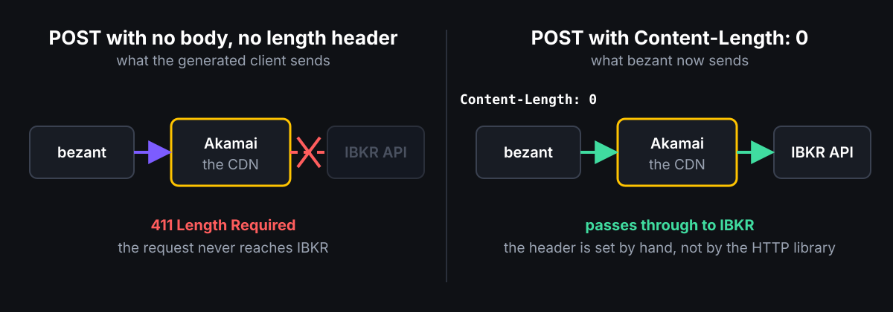

Zack Design's **[bezant](https://github.com/isaacrowntree/bezant)** is a typed, asynchronous Rust client for the Interactive Brokers (IBKR) Client Portal Web API, the HTTP interface to a brokerage account. IBKR publishes a machine-readable description of the API, and no code generator will accept it as shipped. bezant repairs it in a **13-step normaliser**, then one script generates **five clients**: a Rust library, an HTTP server any language can call, a command-line tool, a Model Context Protocol (MCP) server for AI coding tools, and a TypeScript package. It is the first Rust project we have open-sourced. **MIT or Apache-2.0 licensed.**

<div class="hero-cta-row" style="margin: 1.5rem 0;">
  <a href="https://github.com/isaacrowntree/bezant" target="_blank" rel="noopener" class="btn btn-primary btn-lg">Source on GitHub</a>
  <a href="https://isaacrowntree.com/bezant/" target="_blank" rel="noopener" class="btn btn-outline-primary btn-lg">Documentation</a>
</div>

This post covers:

- why it exists, and the one script that generates all five clients;
- the thirteen things wrong with IBKR's spec, and the snapshot test that wrote the last fix;
- the authentication endpoint that sends a redirect (302) where the spec promises 401;
- the CDN in front of IBKR that rejects empty POSTs unless the request states its length;
- running it for real, the six hand-written MCP tools, what is tested, and how to try it.

<!-- more -->

## Why it exists

The Client Portal API is 154 paths, 167 methods and 1030 types. IBKR publishes an OpenAPI document for it, a machine-readable description of every endpoint, so a code generator should turn it into a typed client in one command.

In practice it won't go through `oas3-gen` or Progenitor, two tools that turn such a description into a Rust client. Around 50 operations have no `operationId`, the name a generator gives each method. At least one `operationId` is used twice. The security sections list a `null` where a permission scope should be. Fields declared as integers have decimal example values.

bezant keeps a copy of the spec in the repository, repairs it, and generates everything from the repaired copy. Two sections below are about the running Gateway, the local proxy process IBKR requires between your code and its servers. That is where it stops doing what its own documentation says.

## One script generates five clients

`scripts/codegen.sh` is the whole pipeline. `normalize-spec.py` rewrites the copied JSON in place. `upgrade-to-3.1.py` upgrades it from OpenAPI 3.0 to 3.1. Then `oas3-gen generate ... client-mod` writes the generated Rust into `crates/bezant-api/src/generated/`. Everything else in the workspace is either hand-written on top of that crate or generated from the same normalised document.

| Crate or package | Purpose |
|---|---|
| **`bezant-core`** | The hand-written Rust layer you call: `Client`, session keepalive, health check, WebSocket streaming, pagination, symbol cache, typed errors |
| **`bezant-api`** | Generated Rust client covering every endpoint of the API |
| **`bezant-server`** | HTTP server (built on axum) that exposes the API as plain JSON over HTTP for any language |
| **`bezant-cli`** | Command-line tool: `bezant health`, `bezant positions DU123456`, `bezant conid AAPL` |
| **`bezant-mcp`** | Model Context Protocol server over standard input and output, for Claude Code, Cursor and Continue |
| **`bezant-client`** | TypeScript client for Node, Deno and the browser, generated from the same spec by `codegen-ts.sh` |

The hand-written layer is what you write against. The generated crate has 167 methods named after IBKR's `operationId`s (or the ones we synthesised), and nobody wants to remember those:

```rust
use std::time::Duration;

#[tokio::main]
async fn main() -> bezant::Result<()> {
    let client = bezant::Client::new("https://localhost:5000/v1/api")?;
    let _keepalive = client.spawn_keepalive(Duration::from_secs(60));
    client.health().await?;

    let positions = client.all_positions("DU123456").await?;
    let aapl = bezant::SymbolCache::new(client).conid_for("AAPL").await?;
    println!("{} positions; AAPL = conid {aapl}", positions.len());
    Ok(())
}
```

`spawn_keepalive` exists because a Gateway session dies after about five minutes idle. The background task pings it every 60 seconds and returns a handle. Dropping the handle stops it.

## The thirteen things wrong with the spec

The spec is not wrong so much as never validated. Each of the 13 transforms in `scripts/normalize-spec.py` is a separate function with a counter. The script's last line tells you exactly what it touched:

```
normalized: stripped {nulls} null scopes, added {ids} operationIds, renamed {dedup} duplicates,
desugared {enums} ambiguous enums, rewrote {cts} exotic content types, ...
widened {widened} integer fields, collapsed {multi} multi-content responses
```

The steps, in the order they run:

1. Remove the `null` entries from the security scopes; OpenAPI 3.0 allows an empty list or a named scope there, not `null`.
2. Give the roughly 50 operations that have no `operationId` one built from their HTTP method and path.
3. Rename duplicates: `getTradingSchedule` appears on two paths, so later occurrences get a suffix derived from the path.
4. Turn enums into plain strings when their values (`>=`, `<=`, `>`, `<`, `==`) would all become the same Rust identifier once the symbols are stripped.
5. Rewrite responses declared as `application/jwt` (a signed token) to plain text with a string schema.
6. Make enum values match the declared type, for example a field declared as a number whose enum is the strings `"0"`, `"1"` and `"2"`.
7. Move parameters declared as part of the path, but whose placeholder never appears in the URL, into the query string.
8. Drop `format: "jwt"`, which is not a string format any generator knows.
9. Rewrite cookie parameters as header parameters, because Progenitor does not support cookies.
10. When a successful response is offered as both JSON and PDF, keep JSON.
11. Drop operations whose only response is `101 Switching Protocols`; those are WebSocket upgrades, not REST calls.
12. Declare query parameters that are lists of integers as strings instead, because the generator's comma-separated list type only handles strings.
13. Change integer fields to floating-point numbers when the spec's own example payloads carry decimals in them.

Each transform is written to be deleted the day IBKR fixes the matching thing upstream. Since v0.3, 14 Rust tests in `bezant-spec` pin what each step guarantees. A CI job re-runs the normaliser on its own output and fails unless nothing changes. The full list with reasons is at [Spec normalisation](https://isaacrowntree.github.io/bezant/internals/normalisation.html).

## The snapshot test that wrote step 13

Step 13 was not designed; it was found. `scripts/extract-examples.py` pulls every example payload out of the spec into `crates/bezant-core/tests/fixtures/examples.json`, grouped by `operationId`. Then `tests/examples.rs` tries to parse each one into the generated Rust type:

```rust
for case in cases {
    let result: Result<T, _> = serde_json::from_value(case.value.clone());
    if let Err(e) = &result {
        panic!("deserialise failed for {op_id}/{}: {e}\n  payload: {}",
               case.example_name, case.value);
    }
}
```

The first run failed on `SMA: 368538.0`. The spec declares `SMA`, `balance`, `accruedInterest` and their siblings as integers. IBKR's own example ships them with decimals, and the generator had faithfully made them 32-bit integers.

The wrong fix is a type cast in the hand-written layer. The fix that survives the next spec revision is a normaliser step. It walks every example, finds every integer-typed field holding a decimal, and widens the schema. It widened 37 fields on IBKR's spec. If IBKR adds a 38th, the snapshot test fails before a user does.

That is the pattern for the whole normaliser: a failing test becomes a transform, never a hand patch to generated code.

## The spec says 401. The Gateway sends 302.

`/iserver/auth/status` is documented to return 401 when there is no session. The real Client Portal Gateway responds with a 302 redirect to its login page. The generated client files any status code the spec did not mention under a catch-all `Unknown` error. So the "please log in" signal surfaced as a server error (500) with the message "unknown auth_status response".

`Client::auth_status` in `bezant-core` now skips the generated parser. It sends the request itself and reads the status code directly. A 401, or a redirect to IBKR's sign-in pages, becomes `Error::NotAuthenticated`. Any other redirect surfaces with its real status and target. A success is parsed as a typed `AuthStatus`.

It is a small function, and the most important one in the crate. Every other call's failure mode depends on it.

## The CDN in front of IBKR rejects empty POSTs

The second divergence is not in IBKR's code at all. `api.ibkr.com` sits behind Akamai, a content delivery network (CDN). Akamai rejects a POST that arrives with neither a `Content-Length` header nor chunked transfer encoding, answering `411 Length Required`.

The API has several POST endpoints that take no body: `/iserver/auth/ssodh/init`, `/iserver/reauthenticate`, `/tickle`. For an operation with no request body, the generator emits `self.client.post(url).send()`. That makes reqwest, the Rust HTTP library, omit the `Content-Length` header. The typed client folds the 411 into `Unknown`, and `/health` reports "unknown auth_status response" with nothing in the logs to say why.



I got this wrong twice before getting it right. The first theory was HTTP/2. reqwest negotiates HTTP/2 during the TLS handshake, and an HTTP/2 POST with no body carries no `Content-Length` header. Pinning the client to HTTP/1.1 was the first change, and the 411s continued.

The second try gave the request an explicit empty body, so that hyper, the HTTP engine under reqwest, would write `Content-Length: 0`. `.body(Vec::<u8>::new())` alone still tripped the 411 in some combinations. That looks like hyper choosing chunked encoding for a body whose length it did not know was zero.

What works is setting the header yourself. The generated crate gets the empty-body form injected by a find-and-replace step at the end of `codegen.sh`:

```python
patched = src.replace(
    "self.client.post(url).send().await?",
    "self.client.post(url).body(Vec::<u8>::new()).send().await?",
)
```

The hand-written layer's own raw POSTs set `Content-Length: 0` explicitly. The HTTP server does the same on every proxied POST, PUT and DELETE, with the exact byte length of the body it forwards. None of this is in the spec, because the spec describes IBKR's service and the 411 comes from the CDN in front of it.

One call slipped through. `tickle()`, the keepalive ping, still went through the generated client. It failed with a 411 once a minute, and sessions expired after five idle minutes anyway. Nobody noticed during development, because I was logging in again every few minutes. A fix in May gave `tickle()` the same raw POST as `auth_status`.

## Running it for real

Deploying it taught three more things, all now in the README and the server.

- **IBKR refuses cloud data-centre addresses.** Run bezant-server on a hosting platform and the sign-in handshake gets a 401, and every call after it fails. The pattern that works is a Raspberry Pi at home. Cloudflare WARP routes its outbound traffic, Cloudflare Tunnel exposes it without opening a port, and Cloudflare Access lets in only you and your bot.
- **The Gateway can be up and wrong.** On 3 September 2026, `/iserver/auth/ssodh/init` (the step that turns a browser login into a session) returned 500 for eleven hours. Everything else looked like a normal logged-out Gateway. `/health` now reports that handshake's state, and the container restarts the Gateway after five failures in a row, but only while logged out, when a restart costs nothing.
- **The server trusts whoever can reach it.** It does not check callers, and its cookies can trade the account. After a security researcher's report, v0.4 listens on `127.0.0.1` by default and warns when bound wider.

bezant-server can also hold a WebSocket open to the Gateway and keep the order, fill and profit-and-loss events it sees. Programs that poll page through them at `/events/*` with a cursor, so nothing is missed between polls.

## Six MCP tools, written by hand

`bezant-mcp` speaks the Model Context Protocol over standard input and output using the `rmcp` library. It takes the Gateway URL from `IBKR_GATEWAY_URL` and runs its own 60-second keepalive.

The tools are not generated from the spec. There are six, defined with `#[tool]` in `crates/bezant-mcp/src/lib.rs` on top of `bezant-core`: `health`, `list_accounts`, `account_summary`, `positions`, `conid_for` (cached through `SymbolCache`) and `tickle`.

That is deliberate. 167 generated tools would give a model 167 ways to be wrong about `operationId`s. Six tools, with descriptions like "call `health` first if anything returns not-authenticated", are a set a model can actually drive.

## What is tested

Every test in the workspace runs in CI. Besides unit tests, the snapshot suite and the normaliser invariants, `crates/bezant-server/tests/routes.rs` starts a fake Gateway with `wiremock`, a mock HTTP server library. It checks things like `health_maps_unauthorized_to_401_with_code`, `accounts_passthrough_forwards_body_verbatim` and `account_positions_defaults_to_page_zero`.

## Trying it

The quickest start is Docker, which runs IBKR's Gateway and bezant-server together:

```sh
git clone https://github.com/isaacrowntree/bezant
cd bezant
docker compose up
```

Log in once at `https://localhost:5000`, then check that the server sees the session:

```sh
curl http://localhost:8080/health
curl http://localhost:8080/accounts
curl "http://localhost:8080/accounts/DU123456/positions?page=0"
```

The command-line tool and MCP server are on crates.io:

```sh
cargo install bezant-cli
bezant health
bezant positions DU123456 --output table
bezant quote AAPL

cargo install bezant-mcp
```

MCP clients run the `bezant-mcp` command with `IBKR_GATEWAY_URL` set to `https://localhost:5000/v1/api`. Start on a paper account.

## Status and licensing

- **Alpha, v0.4.** Works end-to-end against IBKR paper accounts, and is the access layer for [Sovereign](https://github.com/isaacrowntree/sovereign-ibkr-fund). The public API will move until v1.0.
- **Dual-licensed under MIT or Apache-2.0**, the Rust convention.
- **Not affiliated with Interactive Brokers.** The vendored spec is IBKR's; it is included for interoperability.
- **Docs:** [isaacrowntree.github.io/bezant](https://isaacrowntree.github.io/bezant/)
- **Source:** [github.com/isaacrowntree/bezant](https://github.com/isaacrowntree/bezant)

Two things carried over from this project. A third-party spec is input data, not a contract. The right place to fix it is a normaliser with a counter per fix, and a test that fails when the fix stops being needed.

And the interesting failures were never in the spec or the generator. They were in the layers the spec does not describe: the Gateway's redirect, and the CDN's rules about how a request states its length. The only way to find them was to run typed calls against the real thing and read the status codes. Contributions are welcome, particularly new normaliser steps and new client languages.
