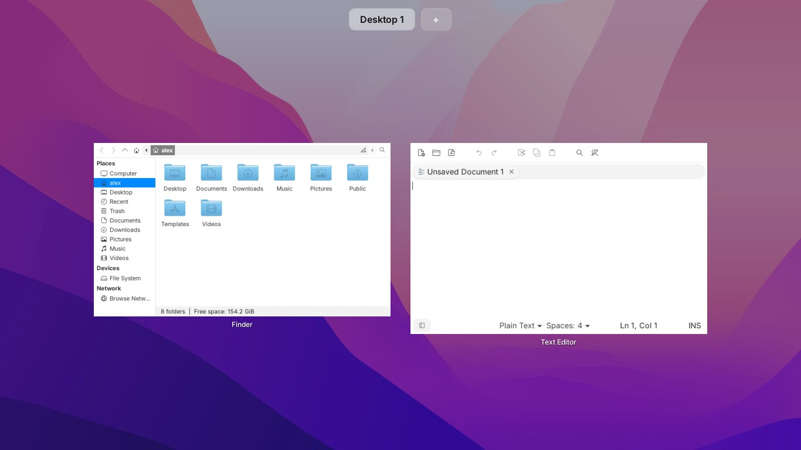
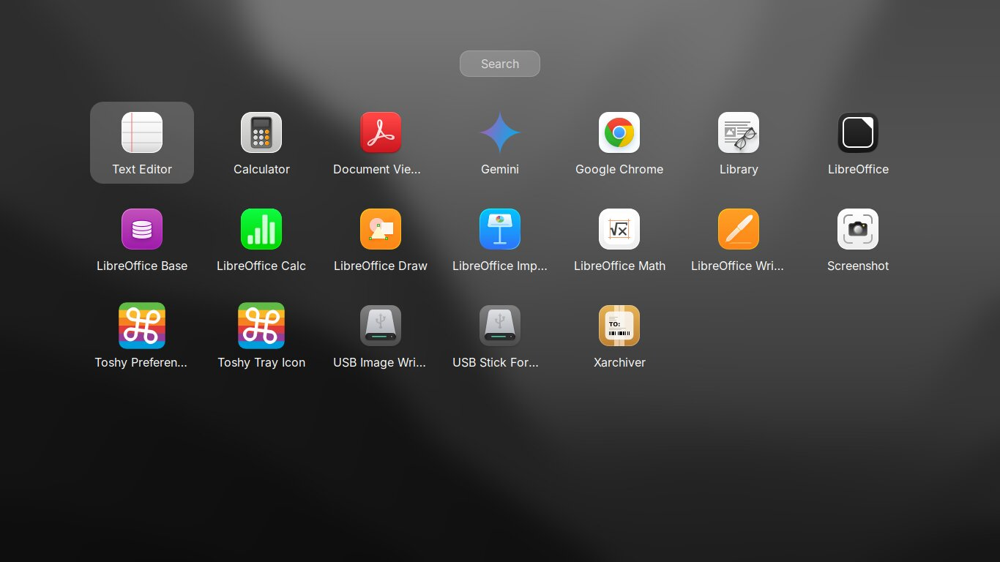

Zack Design has published **[mintosh](https://github.com/isaacrowntree/mintosh)**, a set of scripts that makes **Linux Mint** look and work like the latest macOS. It's meant for old Macs that Apple no longer updates, and it covers the whole move: back up the Mac, sort the files, install Mint, then run three scripts for the system, the look and the keyboard.

It was built for one person: the owner of a 2013 MacBook Air with 4 GB of memory, whose last macOS was Big Sur, and who shouldn't have to learn anything new to keep using it. So the bar wasn't "Linux that looks a bit like a Mac". It was: the Apple menu is where it was, ⌘C and ⌘Tab do what they did, Spotlight is on ⌘Space, and every file is where it was left.

This post covers:

- what a theme gives you, and the much bigger part it doesn't;
- why, on 4 GB, nothing gets to run in the background;
- Mission Control, and two bugs that made it look broken;
- why Launchpad is secretly two windows;
- three ways the light/dark switch appeared to do nothing;
- a crash in Ubuntu's menu-bar plugin, tracked down and fixed;
- a glass effect that kept switching itself off;
- sleep, battery and memory the way a MacBook handles them;
- the things a Mac does quietly that Linux can do but doesn't switch on;
- what the tests check, and what they deliberately leave alone.

**MIT licensed.**

<!-- more -->

**Source → [github.com/isaacrowntree/mintosh](https://github.com/isaacrowntree/mintosh)** (MIT)

## A theme is the easy 20%

The look comes from people who have already done it well. [MacTahoe](https://github.com/vinceliuice/MacTahoe-gtk-theme) is a careful copy of macOS Tahoe's windows, icons and cursors. [picom](https://github.com/yshui/picom) draws the frosted-glass blur, [Toshy](https://github.com/RedBearAK/toshy) makes the ⌘ key behave, Plank is the dock, and Touchegg reads trackpad gestures.

Install all of that and you get something that looks like a Mac in a screenshot and nothing like one once you use it. Most of mintosh is the glue between those projects:

- **The menu bar.** The Apple menu, then the current app's name in bold and *its* File, Edit and View menus, moved out of the window and into the bar, as on a Mac. The status icons are in macOS's order, and the clock reads "Mon 26 Oct 9:41 AM". There's no solid bar: as in Tahoe, the text sits straight on the wallpaper.
- **The Apple menu.** About This Computer, System Settings, Appearance, App Store, Force Quit, Sleep, Restart, Shut Down, Lock Screen and Log Out, with the dividers where macOS puts them.
- **Keys and gestures.** ⌘C, ⌘V, ⌘Q, ⌘W and ⌘Tab. ⌘⇧3 saves "Screenshot 2026-10-26 at 09.41.12.png" to the Desktop without asking where. F3 and F4 do what's printed on them. Three fingers up opens Mission Control, three fingers sideways changes desktop, and pinching with thumb and three fingers opens Launchpad.
- **The 2013 hardware.** Without a startup setting, the Mint installer can't see this Air's SSD. Once installed, the desktop froze after about an hour until a power-saving feature for the drive was turned off; the battery saver kept turning it back on, so that needed fixing too. Add Wi-Fi and camera drivers, fan control, and low-battery warnings that agree with the percentage in the menu bar.


## On 4 GB, nothing runs in the background

Chrome alone can fill 4 GB. So the rule was simple: anything macOS keeps running all the time only exists here while it's on screen.

Spotlight and Launchpad use [rofi](https://github.com/davatorium/rofi), a launcher that starts when you call it and quits when you close it. I tried Ulauncher first, the usual Spotlight stand-in on Linux, but it sits in memory at 100 MB or more. On this machine that's a whole browser tab.

Mission Control is a small Python program that opens, shows live previews of every window (even ones hidden behind others), and quits when you're done. The bar across the top holds your desktops: click one to go there, + to add one, ✕ to remove the last. Drag a window's preview onto a desktop to move it there.



Two bugs in it are worth a mention, because from the outside both just looked like "it doesn't work":

- **Dragging a window onto a desktop did nothing.** The code that says "this can be dragged" has to be set up before the code that handles clicks. It was the other way round, so the click handler swallowed every press and a drag never started. The fix was swapping two lines.
- **Every Finder window was labelled "Bulk Rename".** Labels use each app's friendly name ("Calculator", not `gnome-calculator`). But Finder's hidden bulk-rename tool is the same program underneath, and it was found first. Ignoring hidden tools fixed it.

## Launchpad is secretly two windows

On a Mac, clicking anywhere outside Launchpad's icons closes it. rofi can close on an outside click, but only if its window doesn't cover the whole screen, and Launchpad does.

So Launchpad is two windows:

1. At the back, a full-screen picture of your wallpaper, blurred and dimmed.
2. In front, rofi as a box in the middle of the screen, with the matching piece of the same picture as its background.

The two line up exactly, so it looks like one surface. A click outside the box lands on the back window, and both close. It lists the same apps as Mint's own menu, so nothing goes missing in the move.



Then a worse surprise. If you typed something that matched no app and pressed Return, rofi tried to *run your words as a command*. "settings manager" + Return gave a full-screen error, *Failed to execute: 'settings manager'*. The error was the harmless part. The real problem was that typed text was being run at all. Now Spotlight and Launchpad only ever start installed apps, and anything else does nothing, which is also what a Mac does.

## Three ways the light/dark switch seemed to do nothing

Apple menu → Appearance… switches between Light, Dark and Auto (light from 7 am to 7 pm). It changes everything that has two looks: windows, icons, the menu bar, the dock, Spotlight, Launchpad, Mission Control, notifications, the wallpapers, and apps like Chrome that follow the system setting.

Each of these bugs looked like the switch simply hadn't happened:

| What you saw | Why | Fix |
|---|---|---|
| Plain grey window buttons instead of red, yellow and green | On the first run the theme was selected a few seconds before it was installed, and Xfce only reloads a theme when its *name* changes | Select a different theme for a moment first, then the right one |
| Black menu-bar text on a dark wallpaper | The menu bar only reads its colours when it starts | Restart the menu bar after switching |
| No blur, no rounded corners, no shadows | picom didn't understand one line of its settings, printed an error nobody saw, and quit | Two characters in that line |

The third went unnoticed longest, because Xfce quietly took over with its own, plainer effects and it looked *almost* right.

## A crash in the menu bar, tracked down and fixed

On the real Air, moving a Chrome window to another desktop popped up an Xfce error: "plugin unexpectedly left the panel". The crash report pointed at the part of the menu bar that shows each app's File and Edit menus. It's a plugin called `xfce4-appmenu-plugin`, and Ubuntu 24.04, and so Mint 22, ships version 0.7.6.

With Ubuntu's debugging information downloaded, the crash pointed to one function. In plain terms: when an app's menu disappears, as Chrome's does when its window changes desktop, the plugin cancels its pending request for that menu and throws the menu away. The cancelled request still reports back, though, and the first thing the reply handler does is look at the menu that's already been thrown away. Here's the start of it, for anyone who reads C:

```c
static void get_layout_cb(GObject *source_object, GAsyncResult *res, gpointer user_data)
{
	if (!DBUS_MENU_IS_MODEL(user_data))   /* looks at the menu first ...            */
		return;
	...
	dbus_menu_xml_call_get_layout_finish(..., &error);
	if (error != NULL)                    /* ... before checking it was cancelled   */
		return;
```

The plugin's other handlers already do these two steps the right way round; this one doesn't. The fix swaps them.

There's no fixed version to install, so mintosh's system script now builds one. It downloads Ubuntu's own source code for the plugin, applies the fix, builds just the menu-bar part, and puts it in place. Then it removes the build tools again, so they don't take up space on a small drive. It only does this for that exact version, and a future Ubuntu update simply replaces it.

## A glass effect that kept switching itself off

picom, the program that draws the glass, had its own problem. Every so often, usually when the menu bar restarted, it hit one of its own internal safety checks and shut down, and the glass stayed off until the next login.

I didn't go digging into picom. Instead it now runs inside a tiny wrapper that starts it again whenever it crashes, and leaves it alone when it's stopped on purpose:

```sh
while :; do
  picom "$@"; rc=$?
  [ "$rc" -eq 134 ] || exit "$rc"   # 134 means it crashed; anything else was deliberate
  sleep 1
done
```

On the Air, three menu-bar restarts in a row caused two crashes, and neither was visible.

## Sleep, battery and memory, the way a MacBook does it

Linux can do everything a Mac does with its battery. It just doesn't switch most of it on, so mintosh does.

**Sleep that lasts weeks.** Close a Mac's lid and it sleeps. After about three hours asleep it quietly copies its memory to the SSD and powers off completely, which Apple calls standby. Open it a week later and it's exactly where you left it. mintosh sets up the same thing: every way of going to sleep (the lid, Apple menu → Sleep, sitting idle, a flat battery) goes to sleep first, then to disk after three hours. That needs a swap file as big as the memory and a couple of startup settings, which the system script adds when there's room and leaves alone when there isn't.

On the Air, with the delay cut to 45 seconds for the test:

| Time | What happened |
|---|---|
| 23:01:03 | Asleep |
| 23:01:50 | Woke itself, saved 688 MB of memory to disk, powered off |
| 23:04:22 | Power button: back where it was, at the password prompt, Wi-Fi connected, camera working |

The Wi-Fi and camera drivers on these Macs don't handle sleep well on their own, so a small hook unloads the camera before sleep and reloads it after, and gives the Wi-Fi driver a fresh start after a resume from disk.

**A flat battery loses nothing.** At 5 % it saves to disk and powers off, as a Mac does, instead of dying with unsaved work open. The "Low Battery" warning at 10 % stays on screen until it's closed.

**The screen turns off, not just black.** On battery the display dims at 2 minutes and switches off at 3. Blanking it to black would leave the backlight, the biggest single power draw, burning behind an empty screen.

**The keyboard lights up in the dark.** A MacBook has a light sensor next to the camera. mintosh reads it: the keys light up in a dim room, stay dark in daylight, and go off after 30 seconds without typing, coming back at the next key press. The brightness keys still work, and a level set with them is kept.

**The processor gets to rest properly.** An idle Haswell processor like this Air's should spend most of its time in its deepest sleep states, where the whole chip draws about a watt. On Linux it never got past the shallowest one, and drew nearly three. Two things were holding it awake, and both come from how Apple's firmware sets the Mac up:

- **The camera's connection never idled.** The FaceTime camera hangs off its own PCIe link, which the firmware brings up with power saving switched off. Linux keeps the firmware's settings, and one link that never idles is enough to keep the whole chip awake. mintosh switches that link's power saving on at start-up and after every sleep.
- **Thunderbolt stayed powered.** Linux introduces itself to a Mac's firmware as macOS, so the firmware keeps the Thunderbolt controller on, expecting macOS to manage it. Telling the firmware not to expect macOS lets it switch Thunderbolt off at start-up. Thunderbolt devices then have to be plugged in before the Mac starts, which for this Air's owner means never.

| Idle, screen on | Before | After |
|---|---|---|
| Processor package | 2.8 W | about 1 W |
| Whole laptop (battery) | 7.1 W | about 4.3 W |
| Time in the deepest sleep state (PC7) | 0 % | about 60 % |

That's roughly 11 hours of idle battery instead of under 7, from the same 47 Wh battery.

**Memory gets compressed before anything waits on the disk.** macOS squeezes memory it isn't using, which is a big part of why a 4 GB Mac copes with a browser full of tabs. Linux has the same thing (zswap) but leaves it off. mintosh turns it on, and adds earlyoom, which closes the biggest app if memory really runs out rather than letting the whole desktop freeze.

**YouTube plays on the graphics chip.** A 2013 Air's graphics chip can decode H.264 video itself, using very little power, but YouTube sends VP9 by default, which the processor has to decode in software. A small extension, h264ify, is installed through Chrome's own policy settings so YouTube sends H.264, and Chrome's hardware video decoding is switched on.

## What a Mac does quietly, and Linux can do but doesn't switch on

The rest are small things the owner should never have to think about:

- **Force Quit** (Apple menu, or ⌘⌥Esc) lists the open apps, as on a Mac, not a page of system processes.
- **Accents work the Mac way:** ⌥e then e for é, ⌥n then n for ñ.
- **No Mint pop-ups.** No welcome window at every login, no update shield: updates install themselves.
- **Logging out and straight back in** brings back the dock, the menu bar and the ⌘ keys straight away.
- **A firewall that lets nothing in**, and remote login by key only.
- **A kernel update can't take the Wi-Fi away.** The Wi-Fi and camera drivers are rebuilt for each new kernel. The camera's build can never stop an update, and if a new kernel ever starts without its Wi-Fi driver, the Mac starts the previous kernel instead until an update fixes it. Without Wi-Fi there'd be no way for that update to arrive.
- **Helping from another Mac closes itself.** The setup tools give the helper temporary access, and it ends by itself after 48 hours even if nobody remembers to close it.

## What the tests check, and what they leave alone

mintosh is tested in a Mint virtual machine on a Mac (using [OrbStack](https://orbstack.dev)), at the Air's screen size. The test presses keys and clicks the mouse, and finds buttons by their names the way a screen reader does, so it doesn't break when something moves. It checks that:

- each shortcut opens the right thing;
- Launchpad fills the screen, opens an app with one click, opens the best match on Return, ignores Return when nothing matches, and closes with Esc, with F4 again, or with a click outside;
- Mission Control names windows after their apps, adds and removes desktops, moves a dragged window, brings a clicked window to the front, and closes all three ways;
- each trackpad gesture does what it should.

It doesn't test Toshy or Touchegg, the keyboard and gesture projects mintosh builds on; both are well tested by their own authors. An earlier version did try, using fake keyboards and trackpads, and mostly ended up testing the virtual machine instead: it turned out the VM only ever set up two of them, so the rest silently didn't exist. Now the test sends the keys Toshy would send and runs the commands mintosh gives Touchegg. That's the part mintosh is responsible for.

The other test is the Air itself, and the person who uses it.

## Try it

On any computer running Linux Mint 22 Xfce, Mac or not, install the handful of packages the [README](https://github.com/isaacrowntree/mintosh#mintosh) lists, then run scripts 3, 4 and 5 from [step 4](https://github.com/isaacrowntree/mintosh#4-set-up-on-the-new-install). The Mac hardware fixes only switch on when that hardware is there. Everything is in English by default, with a second language as an option. If you're moving someone off an old Mac, steps 1 and 2 back it up and sort their files before anything is wiped.

Issues and pull requests are welcome, especially from anyone with a 2014 or 2015 MacBook to try it on.

*Header photo by [Markus Spiske](https://unsplash.com/@markusspiske) on [Unsplash](https://unsplash.com).*
