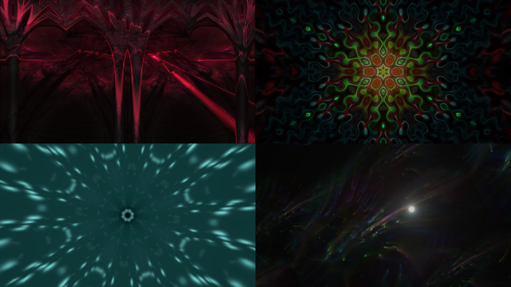
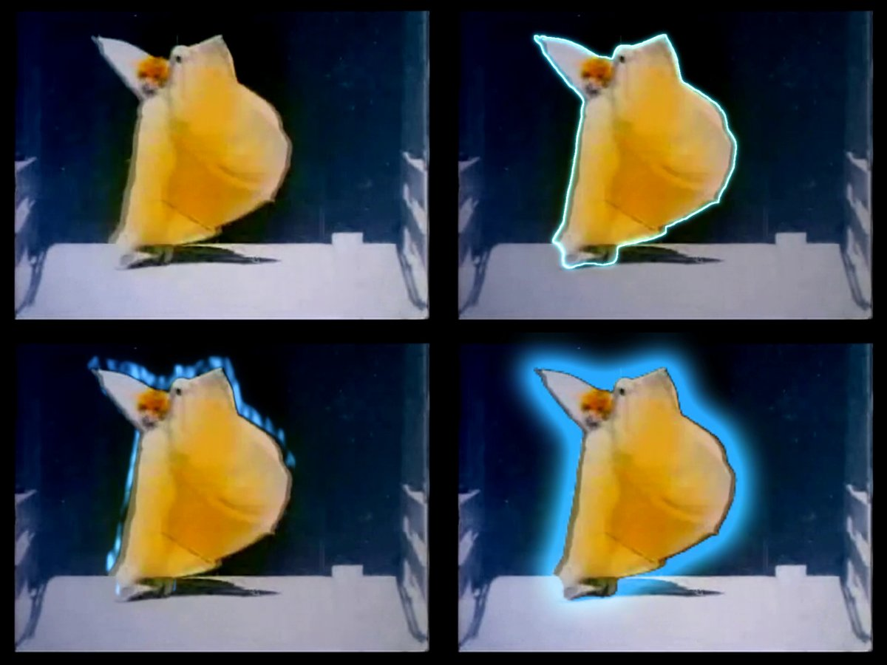

Zack Design has published **[focalcut](https://github.com/isaacrowntree/focalcut)**, an MIT-licensed tool for cutting dance and event footage by who the camera is following. Point it at a folder of dance footage and it finds where the camera's attention moves from one dancer or couple to the next, then exports per-subject clips and a timeline for Premiere, DaVinci Resolve, Final Cut or Avid. Point it at a curated folder from a festival and it cuts **recap reels**. Each reel comes as a landscape and a portrait cut on the music's beats, told in acts, with velocity edits, motivated transitions, portrait reframing that follows a dancer, shake checks and an optional MilkDrop light show. Each comes with a Premiere XML so an editor can keep working, and a review page for choosing, banning and reframing shots.

This week it cut seven reels from three shoots: landscape and portrait for an EDM festival and a Latin street festival, and three cuts for a salsa congress. This post covers how focalcut finds the subject, the editing rules it encodes and why each is its own piece of code, the one rule above all of them (**the editor's picks always win**), and four things that broke on real footage and how they were fixed.

<!-- more -->

## The problem

A festival shoot leaves hours of footage of people dancing. A reel needs about three minutes of it, and the people in the footage are the ones who watch the reel. So the cut has to land on the beat, frame each dancer whole in both 16:9 and 9:16, and leave nobody out. It also has to look like an editor cut it, not like a slideshow of highlights.

None of that is one model. The hard part is identity under bad conditions. Stage lighting washes every dancer the same colour, lens flare swallows the subject, and dancers spin away from the camera. Frame differencing over-cuts on every spin. Colour and even CLIP-embedding similarity can't tell two magenta-lit couples apart. focalcut started with a SAM 3 detector and an appearance tracker, and that under-segmented crowded floors.

## Splitting a library by subject

What worked was a **contact sheet read by a vision model**. One thumbnail every few seconds turns out to be the most legible identity signal there is: a model reading the grid reasons about clothing, hair, faces and recurrence in a way no box metric can. The library pipeline runs four passes, all built from cheap ffmpeg contact sheets:

1. **Coarse:** a thumbnail every ~8 s per clip; the judge returns candidate cuts.
2. **Refine:** a ±8 s sheet at 2 s spacing checks each candidate is a real couple change, not flare, a spin or a partner rotation.
3. **Ultra:** a ±3 s sheet at 0.5 s spacing pins the boundary to about half a second.
4. **Miss-sweep:** a sceptical second read of the clips with no cut catches hand-overs the coarse pass missed.

The judge is Claude, fanned out one agent per sheet. On a 50-clip portrait library this took about seven minutes and pinned 26 cuts to 0.5 s. This path needs no GPU: `pip install` brings numpy and OpenTimelineIO and nothing else. Timelines are written through OpenTimelineIO's adapters, so drop-frame timecode and mixed frame rates are handled by the library the post industry already maintains.

```bash
focalcut library "/footage" --interval 8 --portrait-only   # contact sheets + a skeleton manifest
focalcut export "/footage" -f fcp7                          # or edl, aaf, otio
```

## From a folder to a reel

`focalcut reel run` works through a chain of cached steps:

- units, score, shake and focus
- subject, semantic, moments and faces
- music, then plan
- render, xml and review

Re-cutting after a review only reruns the last four, which takes minutes. The subject step is where the GPU work is. SAM 3 masks every person, BiRefNet saliency and Depth Anything V2 nearness pick the person the shot is about, and SigLIP 2 scores moves on the subject's crop. So a dancer in motion blur beats a sharp bystander.


The planner cuts the way music videos are cut, and each rule is its own function with its own knob:

| Rule | What it does | Code |
|---|---|---|
| A story in acts | teaser, arrival, shows, night, climax, finale, on the song's section changes | `plan.story` |
| Card shuffle | every clip appears, its shots spread out and dealt between others, never a block | `Picker`, `weave` |
| Cut on the action | a turn cuts to a turn, travel keeps its direction | `flow.py`, `flow_link` |
| Music-video rhythm | 8-beat phrases of varied lengths, peaks on the beat, cuts two frames early | `rhythm`, `ANTICIPATE` |
| Velocity edits | fast through the move (never above 1.5x on dancing), slow on the landing, hold | `velocity.py` |
| Transition grammar | mostly hard cuts; each act has a short vocabulary, and every transition needs a reason | `grammar.py` |
| Portrait framing | the 9:16 strip follows one dancer of a couple dancing apart, favours faces, never cuts through a person | `frame.py`, `plan.reframe` |
| Shake | measured; too shaky moves elsewhere in the clip, mildly shaky is stabilised | `shake.py` |

Because each rule is a function, a teaser or a single dancer's highlight uses the same rules without the full reel. `plan.place()` turns any hand-built list of shots into a plan that renders and exports like a reel. The repo also ships a Claude Code skill that lists every concept with the code behind it.

## The editor's picks always win

The review pages are where the editor comes in. The sources page shows every clip in a big player over a zoomable timeline, with the moments the planner found and where each reel uses the clip. The editor marks in-out picks, bans stretches and sets portrait focal points. The page saves `picks.json` on every change, and the planner cuts again.

The rule that took longest to get right is the simplest to state: **no planner rule overrides a pick.** In code, that means four things:

- **Once each, at real speed.** A pick plays exactly once, at least as long as it was marked, and is never sped up. Slow motion is allowed.
- **A picked clip gives only its picks.** The editor chose its best part, so the rest of that clip is banned.
- **No other shot over a pick's footage**, including quick cuts in the climax that would replay it.
- **A pick check after every plan.** `pick_report` lists any pick that is missing, short, sped up, doubled or overlapped. A clean plan prints nothing.

Picks can still outnumber the song. Electric Nation had 132 picks, bunched in a few long clips, for a 2:45 reel. The planner condenses them: each long pick is cut to its best few beats, and the picks share out a fixed part of the reel's beats. The first pick-heavy cut kept only 90 of the 132, because a per-clip cap meant to spread coverage was throwing away picks from the clips the editor cared most about. That cap is now a setting, `pick_clip_share`. Raising it kept 127 of the 132 in landscape and 126 in portrait.

The editor's standing rulings live in reel.json as **profiles**: named rule sets that a reel or a cut stacks with `"use"`. "Picks-heavy" or "side-on faces are fine" become one word the next event can reuse. **Refill** handles review rounds. It keeps every shot of the last rendered cut and moves only the ones on footage rejected since. Before refill, every re-plan reshuffled about half the cut into shots nobody had reviewed. On the Latin festival that took four rounds and 117 rejections.

## What broke on real footage

### Android oversaturated every reel

Played on an Android phone, the reels came out noticeably oversaturated, while they looked right on a desktop. The shots that had been encoded from raw RGB frames (transitions, effects and the visualiser) carried no colour primaries or transfer characteristics in the H.264 stream. Players guess when those are missing, and Android guesses BT.2020 for 4K, which pushes every colour further out. Passing tags on the ffmpeg command line wasn't enough, because with raw input ffmpeg 8 writes what the input says. So every encode now runs the `h264_metadata` bitstream filter to stamp BT.709 into each sequence header. The final mux and the media copied for the Premiere XML are re-tagged too, so shots cached before the fix are covered.

### A portrait plan that took half an hour

With most clips picked, the Electric Nation portrait plan sat in one function for over thirty minutes. A Python traceback dump every five minutes showed where: the pass that makes sure everyone in the footage appears was rating every candidate spot, and each rating costs a portrait reframe. Most of those spots were on footage already banned, because a picked clip's other footage is banned. They were rated only to be refused later. Filtering banned spots first took the plan to about two minutes.

### Sony 4:2:2 HEVC and a decoder three frames late

The cameras shoot 10-bit 4:2:2 HEVC, which NVIDIA's decoder doesn't support before the RTX 50 series, so on an RTX 4070 Ti it fell back to the CPU. The Intel iGPU's media engine does support it, but not through Mesa's VA-API bridge in WSL. So focalcut decodes those files with a Windows ffmpeg build using Quick Sync, encodes on NVENC, and renders plain shots several at a time: about 4.5 minutes for a 140-shot reel, against about 30 one at a time on the CPU. One catch: at its default queue depth, `hevc_qsv` labels each frame three frames late, so seeking lands three frames early. `-async_depth 1` fixes it, and decoded frames are pixel-identical to the CPU decode.

### Dark faces at night, blown-out faces by day

Daylight shots with a bright white top lost the subject's detail, and some night subjects sat too dark. Exposure is now measured on the subject, not the frame: on faces, or on the people from the head down when no face is seen. A blown-out daylight subject gets a highlight pull. A dark night subject gets a small midtone lift on luma, at most 0.08 at mid-grey, with black and white held so the room stays night and the noise stays down. Both are reel.json settings, with per-clip overrides, rather than fixes made by hand in one edit.

## The light show

For EDM reels, an optional overlay runs real MilkDrop presets over the cut, driven by the mix. projectM 4 renders them on the GPU, off-screen, at a fixed frame time and from the song's own samples, so each frame is exact against the cut. The native renderer replaced a headless-Chromium path and is about six times faster, at around 100 fps at 1080p. The light is keyed in where the footage is dark and fades toward the centre of the frame, where the subject is.



The presets shown are "martin - cope - laser dome", "flexi - jelly fish mandala", "Rovastar + Geiss - Hyperspace - kaleidoscope" and "martin - into the fireworks", by their MilkDrop authors.

## Effects that target the subject

Effects are standalone modules that use the subject's mask, so they light the dancer and not the room. Here they are on Annabelle Moore's *Serpentine Dance*, an Edison film from 1895 and in the public domain:

```bash
focalcut fx apply clip.mp4 -e neon --peak 3.0
focalcut fx gallery clip.mp4          # every effect side by side
```



This film found a bug. SAM 3's "person" mask stops at the arm, and the effect edge was clipped to it, so the white wing held out on a wand fell outside the outline and glow. The edge now comes from BiRefNet's matte wherever it stays joined to the dancer, which also keeps a flung-out skirt or a fan inside the effect.

A reel uses one subject effect, on the drop. The style libraries (glitch, carnival and EDM looks) carry each film's transitions, accents and light show as one choice in reel.json.

## Using it

```bash
pip install "git+https://github.com/isaacrowntree/focalcut"                      # the GPU-free library pipeline
pip install "focalcut[reel] @ git+https://github.com/isaacrowntree/focalcut"     # recap reels and effects
focalcut reel init "/footage/Show 2026" --song track.mp3
focalcut reel run "/footage/Show 2026"
focalcut reel serve "/footage/Show 2026"                                         # review pages on localhost
```

The reel path wants a CUDA GPU (two scoring workers fit a 12 GB card) and ffmpeg. SAM 3 is a gated model under Meta's own licence, so accept it on Hugging Face first. The [documentation](https://isaacrowntree.com/focalcut/) covers install, the library pipeline, recap reels, the editor's picks, every editing concept, and which chip decodes, encodes and renders what. The code is about 19,000 lines of Python with 276 tests.

It's honest about its scope. It is built on dance footage, and its rules (8-counts, couples, social floors) say so. The reels are a strong first cut that an editor finishes in Premiere, not a replacement for one. The source is at [github.com/isaacrowntree/focalcut](https://github.com/isaacrowntree/focalcut), MIT licensed.
