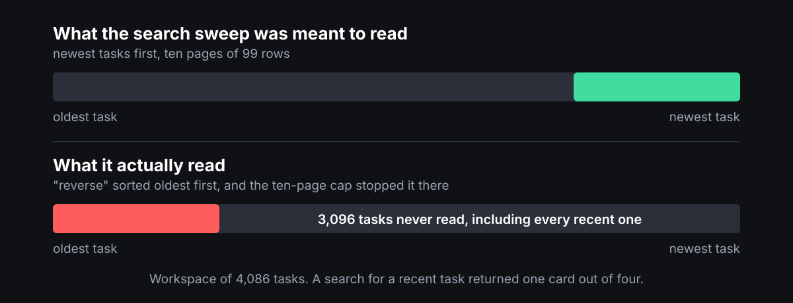

Triptech Travel's **[`clickup-cli`](https://github.com/triptechtravel/clickup-cli)** is a command-line tool, written in Go, for ClickUp, the project-management web app Triptech tracks its work in. It reads the **ClickUp task ID from the name of your git branch**, so `clickup task view`, `clickup status set "review"` and `clickup link pr` need no arguments. It keeps a **local search index**, because ClickUp's own search parameter is silently ignored. Isaac Rowntree wrote and released it as part of his engineering work at [Triptech Travel](https://github.com/triptechtravel); it is cross-posted here on the Zack Design blog. **MIT licensed.**

<div class="hero-cta-row" style="margin: 1.5rem 0;">
  <a href="https://github.com/triptechtravel/clickup-cli" target="_blank" rel="noopener" class="btn btn-primary btn-lg">Source on GitHub</a>
  <a href="https://triptechtravel.github.io/clickup-cli" target="_blank" rel="noopener" class="btn btn-outline-primary btn-lg">Documentation</a>
</div>

This post covers:

- the pattern that pulls a task ID out of a branch name, and the list of words it must ignore;
- the three-stage matcher that turns "review" into the right status name;
- ClickUp's `search=` parameter, which is accepted and ignored, and the local index, built in 38 seconds, that replaced paging through the API;
- a JSON field that is a number until someone logs time and then becomes a string, and a retry policy that refuses to repeat a request that creates things;
- commands that reported success without doing anything, and the `clickup api` escape hatch;
- trying it, why Go, and what was learned.

<!-- more -->

## Why it exists

The ClickUp web app doesn't know which git branch you're on. So you retype the same task ID hundreds of times a week: to read the task, move its status, and link the pull request. The CLI shipped on 3 February 2026, built around one idea. Read the task ID from the branch name, and those commands need no arguments.

It is the most-starred thing released under the Triptech org to date. It had sixteen stars when this was written and forty by November 2026. For a workflow tool nobody marketed, that's a quietly pleasing result.

## Reading the task ID from the branch name

The CLI reads the branch from `git rev-parse --abbrev-ref HEAD`. It matches it with two regular expressions in `internal/git/taskid.go`:

```go
// CU-{alphanumeric} pattern for default ClickUp task IDs
cuIDPattern = regexp.MustCompile(`(?i)CU-([0-9a-z]+)`)

// PREFIX-{number} pattern for custom task IDs (e.g., PROJ-42, ENG-1234)
customIDPattern = regexp.MustCompile(`([A-Z][A-Z0-9]+-\d+)`)
```

Branch prefixes (`feature/`, `fix/`, `hotfix/`, `release/`, `chore/` and so on) are stripped first. Some uppercase branch names look like a custom task ID: `FIX-12`, `RELEASE-3`. An `excludedPrefixes` map rejects those rather than sending them to the API. If both forms are present, the `CU-` form wins. The API receives the bare ID with the prefix removed, because that's what the endpoints expect.

`clickup link pr` then reads the GitHub remote. Two more patterns in `internal/git/context.go` handle the SSH and HTTPS forms of the URL. It then asks `gh`, GitHub's own command-line tool, for the open pull request on the branch.

## Matching a status name from a partial one

ClickUp status names are too long to type. `MatchStatus` in `pkg/cmdutil/status.go` tries three stages in turn:

1. an exact match, ignoring case;
2. a match where the typed text is contained in the status name;
3. a fuzzy match, using `fuzzy.RankMatchNormalizedFold` from the `lithammer/fuzzysearch` library.

The only non-obvious rule is in the middle stage:

```go
if len(containsMatches) > 1 {
    // If multiple contains matches, pick the shortest (most specific).
```

So `"review"` matches `"code review"` rather than `"ready for code review"` when a workspace has both. A miss prints the available statuses rather than guessing.

## ClickUp's search parameter does nothing

I expected `clickup task search "5.6.1"` to be one API call. The documentation for `GET team/{id}/task` lists a `search=` parameter. It returned one card. There were four.

The parameter is accepted and ignored. The same date-ordered page comes back whatever you pass. So what the code called "server-side search (fastest — single API call)" was really the first page of the workspace, filtered locally. Two more defects sat on top of that:

- The search drilled down through tiers (current sprint first, then wider) and stopped at the first tier that found anything. A weak match in the current sprint hid an exact match two pages further on.
- Asking ClickUp for tasks ordered by last update with `reverse=true` gives you the *oldest* first, not the newest. So the sweep was pointed at the oldest thousand tasks in the workspace.



Tests against the live API now pin two things the mocked tests could never have caught. ClickUp returns 99 rows for a nominal 100-row page. So a short page doesn't mean you've reached the end; only an empty page does. And the ten-page cap is real, and it bites on this workspace. The CLI now prints a "Not shown:" line, so an absence of rows doesn't read as an absence of tasks.

## A local index instead

Paging through ten pages on every search is slow, and it still misses the eleventh. The fix is a local index in `internal/taskindex/`. The whole workspace is fetched once. After that, the CLI asks only for tasks updated since the last sync, using ClickUp's `date_updated_gt` filter, one of the few it honours. A week of changes is a single page. The index lives at `~/.cache/clickup/index-<workspace>.json`; `CLICKUP_CACHE_DIR` moves it.

| | Before the index | With the index |
|---|---|---|
| First build | not applicable | 38 s for 4,086 tasks (2.8 MB on disk) |
| A search once the index is warm | 9 s, and only the oldest 1,000 tasks were searched | 0.49 s across all 4,086 |

The index stores subtasks with their parent, so one cache serves both `--include-subtasks` and plain searches. `--no-cache`, `--comments` and `--assignee` bypass it. Comment bodies aren't indexed, and assignee is one of the few filters ClickUp really applies. A missing or corrupt cache falls back to a fresh sync, never an error.

Then my own fixes deleted it. A `--refresh` of a healthy 4,089-entry index left 7 entries, reported itself complete, and answered "No tasks found". Three reasonable rules caused it together:

1. The insert-or-update step skipped any entry equal to what was stored. That avoids rewriting a multi-megabyte file when nothing changed.
2. A completed rebuild dropped any entry not stamped with the time of that rebuild. That's how deleted tasks are removed.
3. The equality check ignored the timestamp, which is correct on its own.

So every task that simply hadn't changed was never re-stamped, looked unseen, and was dropped. The more stable the workspace, the more it deleted. The update step now advances the timestamp on an unchanged entry without forcing a write. A rebuild that would keep less than a tenth of a populated index is refused and reported. Repeated `--refresh` now holds steady at 4,090 entries.

## A field that is a number until time is logged against it

`clickup task view <parent>` failed outright as soon as one subtask had time logged against it (issue #27). There was no name, no status, no siblings, just a `json.Unmarshal` error. ClickUp reports `time_spent` as the number `0` while nothing is tracked. Once something is, it's the string `"2040000"`, in the same response. The generated Go types expected one or the other.

`clickup.Millis` accepts either form and writes back as a number. So `--json` output, and any `jq` filters over it, are unchanged. The Go types are generated from ClickUp's OpenAPI spec, the machine-readable description of the API. We keep a patch over that spec, and an `x-go-type` annotation in it wires `Millis` into every millisecond field.

Review of that commit found the same defect one field over. A time entry's `start`, `end` and `at` swing between string and number exactly as `duration` does. The spec's own stop-timer example shows a string `start` beside a numeric `end`. Stopping a timer is the worst place to break. The timer is already stopped on the server by the time the CLI fails to read the response, so a retry finds no timer running. Request bodies deliberately keep plain integers, because the CLI is the side sending them.

## Retrying failed requests, except the ones that create things

Two calls timed out waiting for response headers during a routine `task edit` and `comment add`. The transport only retried on HTTP 429, the "too many requests" status. `internal/api/retry.go` now makes up to three attempts, waiting 250 ms and then 1 s. It retries on dropped connections and on the 502, 503 and 504 gateway errors.

That applies to GET, HEAD, PUT and DELETE. A PUT applied twice is the same edit. POST is excluded on purpose, because it's the verb that creates a comment, a task or a time entry. A timeout waiting for headers doesn't mean the server did nothing, and repeating it automatically produces duplicates. Instead the user gets:

```
POST request failed without a response (…); it may already have been applied — check before retrying
```

## Commands that said they worked

In July 2026 a list clean-up needed 60 tasks archived. The CLI had no archive command. Worse, `clickup task archive <id>` looked like it worked. Cobra, the Go library the CLI is built on, prints help and exits 0 for an unknown subcommand under a group. Now `clickup task bogus` exits non-zero and names the commands that exist.

Two things came out of that day:

- **`clickup api`**, a generic passthrough to any endpoint, including ones without a dedicated command: `clickup api -X PUT task/abc123 -f archived=true`. `-f` turns `true`, `false`, `null` and numbers into JSON types, because ClickUp silently ignores the string `"true"`.
- **`task archive` and `task unarchive`.** ClickUp doesn't archive subtasks with their parent, which once left three `to do` subtasks alive under an archived task. Archiving now names every subtask it left behind, and `--cascade` includes them.

## Trying it

Install it with the script, Homebrew or Go:

```sh
curl -fsSL https://raw.githubusercontent.com/triptechtravel/clickup-cli/main/scripts/install.sh | sh
brew install triptechtravel/tap/clickup
go install github.com/triptechtravel/clickup-cli/cmd/clickup@latest
```

Then `clickup auth login` with your API token, and `clickup space select` to choose a default space. A typical day:

```sh
# On branch feature/CU-abc123-refactor-auth
clickup task view                 # shows CU-abc123 details
clickup status set "in progress"
# ...write code, open PR...
clickup link pr                   # links the PR to the task automatically
clickup status set "review"
clickup sprint current            # what else is in this sprint?
```

Beyond tasks, it covers ClickUp Docs and their pages, time tracking, comments with @mentions, your inbox, chat and attachments. Every list and view command takes three output flags:

- `--json`;
- `--jq`, for a `jq` expression (the standard command-line JSON filter);
- `--template`, for a Go template.

That's what lets [Claude Code](https://claude.com/claude-code), Copilot and Cursor read and update ClickUp without driving a browser. `--with-token` covers continuous-integration jobs, and `examples/` holds six GitHub Actions workflows.

## Why Go

Go gives a single static binary per platform, with no runtime to install. Shell completion is identical across bash, zsh, fish and PowerShell.

## What was learned

Mocked tests passed while the live API disagreed, twice. So `scripts/smoke.sh` now runs two round trips against a real workspace:

- create a task, search for it, and check it's found;
- log time on a subtask, then read the parent and check it still decodes.

The ClickUp v2 spec is pinned in the repo and patched. Upstream changed it under us, and the documented types aren't the types the API sends. Triptech uses it for all of its engineering work. If you're on ClickUp and spend any real fraction of your day in a terminal, [install it](https://github.com/triptechtravel/clickup-cli) and tell the team what's missing.
