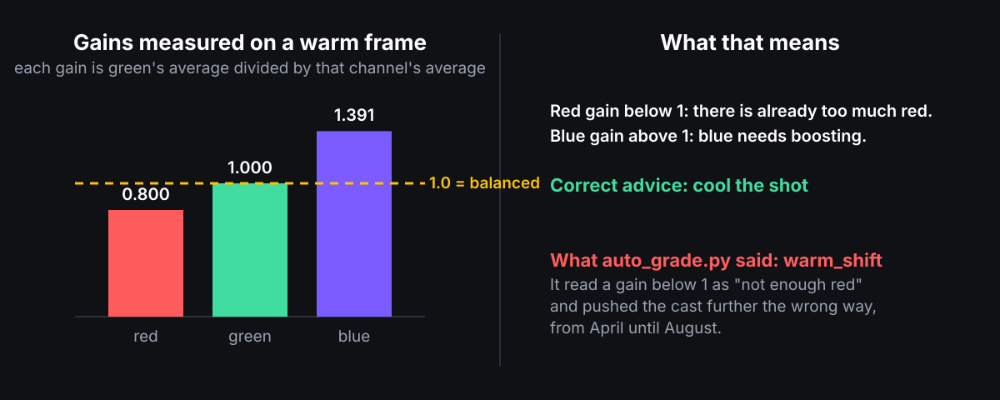

Zack Design's **[color-grade-ai](https://github.com/isaacrowntree/color-grade-ai)** is a Claude Code skill for colour-correcting video. It takes one video frame, measures what is wrong with its colour, and writes a correction as a **LUT** (a look-up table: a file that says, for every input colour, what output colour to show) in the `.cube` text format that DaVinci Resolve, Adobe Premiere Pro and `ffmpeg -vf lut3d` all load. The correction is **fitted by re-measuring** each candidate, using **classical colour science and no machine learning**. On an **eleven-defect evaluation set** it removes 81% of each defect on average. It also tells log footage from display footage before touching exposure. **MIT licensed.**

<div class="hero-cta-row" style="margin: 1.5rem 0;">
  <a href="https://github.com/isaacrowntree/color-grade-ai" target="_blank" rel="noopener" class="btn btn-primary btn-lg">Source on GitHub</a>
  <a href="https://isaacrowntree.github.io/color-grade-ai" target="_blank" rel="noopener" class="btn btn-outline-primary btn-lg">Documentation</a>
</div>

This post covers:

- why it exists, and what the analyser measures at each step of the correction chain;
- the solver that re-measures after each candidate correction, and the eleven-defect evaluation set that scores it (81% of each defect removed on average, 60% in the worst case);
- why tone curves work on true luminance in linear light, not HSL lightness (saturated colours differ by up to 0.37 on a 0-to-1 scale);
- what real footage needs that synthetic scenes don't, and the interactive preview;
- which way a white-balance gain points, what the tests guard against, and trying it yourself.

<!-- more -->

## Why it exists

Dance and party footage under red stage lights makes skin look sunburnt. Hand-tuned LUT presets cover the common fixes, but presets alone mean guessing which one to use, and how hard. This tool replaces that guess with a measurement. Its skin preset's window is deliberately wide, because skin under red practical lights is far more saturated and darker than ordinary skin, and a narrow window ignores every skin pixel in exactly the scenes it is for.

## What a frame is measured for

The pipeline is Python for measurement and Ruby for LUT generation. Ruby needs no gems, and Python needs only Pillow, NumPy and PyYAML. A grade is a chain of steps, which Resolve calls nodes. `auto_grade.py` reports one measurement per node, using classical colour science and no machine learning:

- **Exposure**: where the darkest, middle and brightest parts of the picture sit. The median should be near 45% of full brightness, and it reports how much of the frame sits above 92%, where highlights start to clip.
- **White balance**: the "Shades of Gray" estimate (Finlayson and Trezzi 2004). It averages pixels with an exponent of 6, which leans toward the brighter ones. It is cross-checked against a "White Patch" estimate from the brightest 1% of pixels, and reported as a gain per colour channel.
- **Skin**: a detector for skin-coloured pixels in the YCbCr colour space, shared with the solver. It measures the average hue of skin against the line, at roughly 20 degrees, along which real skin tones sit.
- **Saturation**: the Hasler–Süsstrunk colourfulness measure, reported only when it leaves a plausible band.
- **Black level**: the brightness of the darkest pixels. Blacks below 2% are solid and above 5% read as milky. It also measures shadow noise and checks the shadows are neutral rather than tinted.

```bash
python3 footage_type.py frame.png                 # log or display-referred?
python3 auto_grade.py frame_709.png --emit fix.cube
python3 match_grade.py reference.png shot.png --emit match.cube
python3 sample_clip.py clip.mov --emit fix.cube   # fit across a clip, not one frame
ruby generate_chain_lut.rb studio_balanced.cube \
  studio_punch@0.8 warm_shift@0.3 sat_boost@0.5 black_crush@0.15
```

The `@0.8` suffix is each node's strength. The chain is baked into one `.cube` that loads as a single LUT in any editor. `sample_clip.py` takes the median of 12 frames across a clip, and warns when the clip varies too much for one LUT.

## Fitting the correction by re-measuring

Guessing a strength with a constant like `deviation * 10` or `abs(gamma - 1) * 5` gives no feedback. `solve_grade.py` applies a candidate correction, measures the frame again, and keeps the value that leaves the least error.

Choosing from the preset library doesn't work: it is too gentle. `cool_shift` moves a channel by 4% at full strength, and no combination of presets neutralises a 22% tungsten cast. A solver that picks presets runs out of strength at 1.0 and still fails. So white balance, exposure and black level are fitted directly from the measurement and baked into a LUT by `bake_lut.rb`. Skin stays on the tuned `red_skin_fix` preset, because it corrects a shape, not a magnitude.

`eval_scenes.py` applies known defects to a synthetic scene. `test_eval.py` asserts how much of each defect the grade removes:

| Case | Defect applied |
|---|---|
| `warm_tungsten` | channel gains (1.22, 1.0, 0.78) |
| `cool_daylight` | channel gains (0.80, 1.0, 1.20) |
| `green_led` | channel gains (0.93, 1.12, 0.94) |
| `magenta_stage` | channel gains (1.14, 0.88, 1.10) |
| `underexposed` / `overexposed` | gamma 1.55 / gamma 0.62 with highlight gain 1.08 |
| `milky_blacks` | black lift 0.16 |
| `warm_and_dark`, `cool_and_milky` | combinations of the above |
| `washed_out` / `oversaturated` | saturation 0.32 / 1.95 |

The rules:

- every case must improve;
- at least 40% of each defect must be removed;
- the warm, cool and green casts must cut white-balance error below 60% of the original.

On average 81% of a defect is removed, and the worst case is 60%.

The "pristine" scene sits exactly on the analyser's targets. If it doesn't, some defective versions score better than the original, and the set measures nothing. The solver's stage-by-stage search is greedy, and on some cases it finishes behind the plain, un-searched fit. So it computes both and returns whichever measures better.

Saturation is deliberately not fitted toward a number. A grey warehouse is legitimately drab, and a fruit market legitimately vivid. The evaluation scene measures 63.8; against a fixed target of 45, the advice on that correct scene would be `sat_reduce`. So the metric stays silent anywhere inside a band of 25 to 95, and the report and the solver read the same constant.

## Why tone curves work in linear light

The obvious place to apply a tone curve is HSL lightness (the average of a pixel's brightest and darkest channel) on gamma-encoded Rec.709, the standard encoding of HD video. That is wrong twice.

First, HSL lightness is not how bright a colour looks. A fully saturated red has a lightness of 0.5 but a Rec.709 luminance of 0.21. So a saturated colour and an equally bright-looking grey get adjusted by different amounts, and colours drift against greys. Second, rewriting the lightness and converting back through `hsl_to_rgb` doesn't preserve hue or saturation. And `auto_grade.py` measures true Rec.709 luminance, so the analyser and the generator would disagree about what "luminance" means.

So `generate_lut.rb` works in linear light:

1. Undo the display encoding with the BT.1886 curve (a pure power of 2.4, not the sRGB curve).
2. Apply the tone curve to Rec.709 luminance.
3. Scale red, green and blue by the same ratio, which keeps hue and saturation unchanged by construction.

Where brightening pushes a colour out of range, it is desaturated rather than clipped per channel, which would skew the hue.

Greys come out bit-identical either way. Saturated colours differ by up to 0.37 at the most saturated grid points. Of the 27 shipped LUTs, 14 differ between the two models; the 13 that only adjust hue or saturation are identical. `--legacy` reproduces the HSL-lightness model exactly, checked against its own committed checksums.

`test_luts.rb` checksums every generated LUT against `reference_checksums.yml`, a 4 KB file of SHA-256 hashes rather than 25 MB of reference LUTs. Any change to the maths fails until you regenerate on purpose.

## What real footage needs

Every synthetic case is display-referred Rec.709: the pixel values are already the ones a screen should show. Log footage is different. It is a camera's flat, low-contrast encoding that keeps more dynamic range for grading later.

**Log footage looks broken.** An analyser that assumes Rec.709 reads the lifted blacks and flat contrast as defects, and fits a plausible-looking wrong grade without complaint. So `footage_type.py` measures which encoding it is looking at and states it on every run. There are three outcomes, not two:

- **display**: everything runs;
- **log**: exposure and black level are held back;
- **ambiguous**: a heavily flattened, lifted, desaturated display grade can't be told from log by shape alone, so tone fitting is held back and it asks you. `--transfer` overrides.

The one signal that tells them apart is where the median sits within the frame's range. Rescaling a display image leaves it at 0.446; a log curve moves it. Of two real frames, one cleared that bar and the other, at 0.494, is reported as ambiguous. White balance and skin still run on log, because a cast is a cast whatever the curve.

**Sparse skin can dominate the score.** On one real frame, 1,763 skin pixels drive 58% of the total error. That is 0.021% of the image, and the solver ignores skin below 1% of the frame. Scored that way, the optimiser is graded on a term it isn't allowed to touch, and it removes only 23% of the defect on real footage, against 79% on synthetic scenes. So the reporting and fitting thresholds are one constant, and the skin term is weighted by how confident the detector is.

The obvious skin detector is a box of hue, saturation and value ranges (hue 0 to 50, saturation 0.10 to 0.70, value 0.20 to 0.90). It also selects wood, khaki and amber lamps. The YCbCr region is generous toward flushed and sunburnt skin, which is what `red_skin_fix` corrects, and tight toward wood. `test_eval.py` asserts it rejects wood and terracotta and accepts the full range of skin tones. Leaving skin and saturated props out of the white-balance estimate drops the pristine scene's white-balance error from 0.10 to 0.0003.

## Interactive preview

`preview.html` and `pipeline.mjs` are a JavaScript port of the Ruby LUT engine. Drag in a frame, load a conversion LUT, dial six nodes, and export the chain you're looking at.

The obvious strength slider blends a full-strength LUT's output with the original image. That doesn't match the command line, which scales the preset's parameters instead. Greys agree, but for `studio_punch` at 50% the two differ by up to a quarter of the range on saturated colours. So the preview generates LUTs live at the exact strength you set.

`node --test test_pipeline.mjs` checks the port against Ruby run live, not against committed files. The committed LUTs only pin ten strengths, while the slider offers 101. The test sweeps every preset at every slider value, in both colour models, and they agree to 1e-12.

## Which way a gain points

The analyser reports a gain per colour channel: green's average divided by that channel's average. A gain below 1 means the channel is already too strong, which is easy to read backwards. A synthetic warm cast measures a red gain of 0.800 and a blue gain of 1.391. Read the wrong way round, that frame gets `warm_shift`, which makes a too-warm scene warmer. The green-cast check has the same trap: read backwards, it fires on a magenta cast.



Tests with known warm, cool, green and magenta casts pin the direction. They also run the whole report to the end. A summary that prints before it crashes hides the crash: the output looks complete, and only a perfectly neutral frame would show the error.

## What the tests guard against

An entry point can look fine and still be broken. A script that mixes its error output into its normal output works until a library prints a warning. `analyze_frame.rb` reads its Python helper's JSON and its diagnostics as separate streams, so a Pillow deprecation warning can't land on top of the JSON and crash every run.

Hue needs care too. Averaged as a plain number, the average of 359 and 1 degrees is 180, the opposite colour. Reds straddle that point, and reds are most of what this tool looks at. `analyze_region.py` averages hue as an angle.

The Ruby, Python and Node test suites and the closed-loop evaluation set run on every push, because "the grader got better" needs to be a number.

## Trying it

You need Ruby 2.7 or later to generate LUTs, and Python 3 with Pillow, NumPy and PyYAML to analyse frames. ffmpeg extracts frames and samples clips.

```bash
git clone https://github.com/isaacrowntree/color-grade-ai.git
cd color-grade-ai
pip3 install Pillow numpy PyYAML

ffmpeg -i your_video.mov -ss 00:00:30 -frames:v 1 frame.png
python3 auto_grade.py frame.png --emit fix.cube
ruby generate_lut.rb red_skin_fix skin_fix.cube

python3 -m http.server 8080      # preview at http://localhost:8080/preview.html
```

To use it as a Claude Code skill, clone it to `~/.claude/skills/color-grade` (or `.claude/skills/color-grade` in a project). It also ships a plugin manifest in `.claude-plugin/plugin.json`. Then ask Claude to grade a frame or fix red skin.

The docs site is generated from `SKILL.md` by `generate_docs.rb`, and `test_luts.rb` fails CI if the published page drifts from it.

If you only want the LUTs, you need none of this: `correction_luts/` holds all 27, regenerated from `manifest.yml` and checked for drift in CI.

Source on [GitHub](https://github.com/isaacrowntree/color-grade-ai), full docs at [isaacrowntree.github.io/color-grade-ai](https://isaacrowntree.github.io/color-grade-ai).
