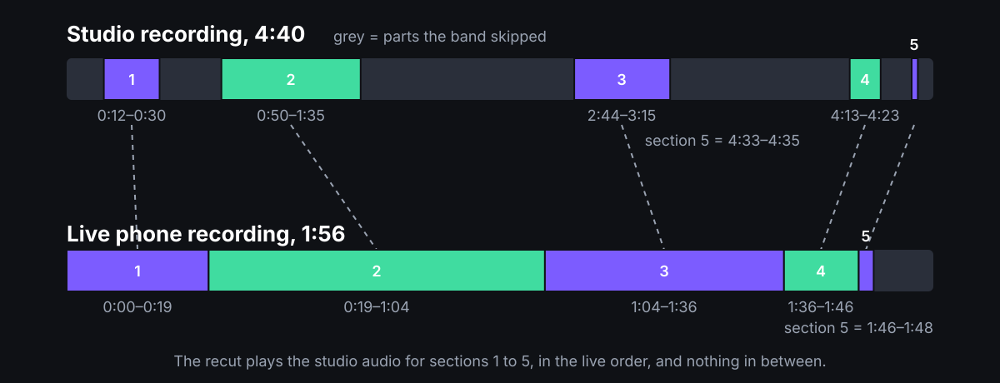

Zack Design's **[audio-analysis-and-recut](https://github.com/isaacrowntree/audio-analysis-and-recut)** is a **single Python script**, plus FFmpeg, that rebuilds a band's live arrangement from the song's studio recording. Given a 1 minute 56 second phone recording of a band playing "Ya Te Olvide" live, it works out which five sections of the 4 minute 40 second studio original they played, and in what order. Then it cuts those sections out of the studio track, so you get **the live arrangement at studio quality**. The matching uses the fast Fourier transform and **no learned components**.

<div class="hero-cta-row" style="margin: 1.5rem 0;">
  <a href="https://github.com/isaacrowntree/audio-analysis-and-recut" target="_blank" rel="noopener" class="btn btn-primary btn-lg">Source on GitHub</a>
</div>

This post covers:

- why the two recordings differ, and why dancers need the recut;
- a filter that keeps only the 200 to 4,000 Hz range, so the vocals dominate and the crowd does not;
- a sliding comparison of 5-second chunks against the whole original, done with the fast Fourier transform and normalised by local loudness;
- grouping the matches into sections wherever the offset stays constant;
- the two-and-a-half-second boundary uncertainty that a 5-second window buys you, and the two manual overrides it needed;
- why the first version's joins were slightly wrong (an MP3 can only be seeked to the nearest compressed frame), and the one-input FFmpeg filter graph, using the sample-accurate `atrim` filter, that fixed them;
- how to run it on your own song.

<!-- more -->

## Why it exists

The studio recording is the one on Spotify. The live recording has the arrangement the band actually plays: the pre-intro skipped, the breakdown compressed, a different ending. It also has crowd noise, the venue's speakers, and a phone microphone's idea of bass.

Dancers at [Havana on the Hastings](https://www.havanahastingsdance.com.au/) rehearse to the studio version and perform to the band's. A choreography that works to one doesn't line up with the other. The recut is the live structure with clean audio to cue on.

## Compare only the vocal range

FFmpeg decodes both files to mono 16-bit samples at 22,050 per second, and NumPy reads them straight from its output. The band-pass filter is the bluntest possible one: transform to frequencies, zero everything outside 200 to 4,000 Hz, and transform back.

```python
def bandpass(audio, sr, low=200, high=4000):
    freqs = np.fft.rfftfreq(len(audio), 1.0 / sr)
    spectrum = np.fft.rfft(audio)
    mask = (freqs >= low) & (freqs <= high)
    spectrum[~mask] = 0
    return np.fft.irfft(spectrum, len(audio))
```

That is crude, and for matching it doesn't matter. The point is to make the comparison depend on the melody and words, not on room rumble and cheering. The average level is subtracted from both signals afterwards.

## Finding where each five-second chunk sits in the original

For each short piece of the live recording, the question is: where in the studio track does this sound most alike? Sliding the piece along the whole original and scoring every position is called cross-correlation. Done directly, it is slow.

The fast Fourier transform turns that sliding comparison into one multiplication. The original is transformed once, padded with zeros to the next power of two. Then a 5-second chunk of the performance is taken every half second. Each one is reversed, transformed, multiplied against the original and transformed back. That gives its match score at every possible position in one pass.

The best position's score is normalised by the chunk's own loudness and by the original's loudness over the same window. The window loudness comes from a running total rather than a loop:

```python
orig_sq = orig_bp ** 2
cs = np.insert(np.cumsum(orig_sq), 0, 0)
...
window_energy = cs[top_lag + chunk_n] - cs[top_lag]
ncc = corr_valid[top_lag] / (chunk_norm * np.sqrt(window_energy))
```

Each chunk yields a time in the performance, a time in the original, a normalised score, and the offset between the two.

## Grouping into segments

A verse played straight through produces a run of chunks that all agree on the same offset. `detect_segments` walks the results and starts a new segment whenever the offset moves by more than 3 seconds. Anything shorter than 2 seconds is dropped as noise. On this recording that produces five segments:

```
SEGMENT MAP:
  1  0:00-0:19  |  Orig 0:12-0:30  |  18.5s  (intro/verse start)
  2  0:19-1:04  |  Orig 0:50-1:35  |  44.5s  (verse/chorus)
  3  1:04-1:36  |  Orig 2:44-3:15  |  31.5s  (montuno section)
  4  1:36-1:46  |  Orig 4:13-4:23  |   9.5s  (ending)
  5  1:46-1:48  |  Orig 4:33-4:35  |   2.0s  (final tag)

Skipped from original:
  0:00-0:12  (11.8s) - pre-intro
  0:30-0:50  (20.1s) - transition/repeat
  1:35-2:44  (69.1s) - repeated verse section
  3:15-4:13  (57.9s) - extended montuno/breakdown
  4:23-4:33  (10.3s) - outro padding
```



The map reads like a cut list. The band skipped the pre-intro, dropped a repeated verse and most of the breakdown, and landed on a different ending.

One thing the recut does differently from the map: it keeps the studio intro. If the first matched section starts more than a second into the original, `build_recut` puts everything before it at the front. Here that is the 12-second pre-intro.

## The cut points were off by up to two and a half seconds

A 5-second window locates a section, not a downbeat. Each boundary can be wrong by up to half the window either way, and the first output made that audible at the first cut.

I fixed this song by hand. Listening, and using the loudness profile to find a natural phrase boundary, gave two overrides:

```python
OVERRIDES = {
    0: {"orig_end": 25.0},      # Cut 1 exit: 0:30.29 -> 0:25.00
    1: {"orig_start": 45.0},    # Cut 1 entry: 0:50.41 -> 0:45.00
}
```

They're in `analyze.py`, applied after the analysis and printed as they're used. I didn't solve the problem generally. A second pass with a shorter window around each boundary would, or beat tracking.

## Cutting all five pieces from one decoded file

`build_recut` decodes the original once and trims every piece out of that one stream:

```python
f"[0:a]atrim=start={seg['orig_start']:.3f}:end={seg['orig_end']:.3f},asetpts=PTS-STARTPTS[s{idx}]"
...
filter_complex = ";".join(trim_parts) + f";{concat_inputs}concat=n={idx}:v=0:a=1[out]"
```

Seeking into the MP3 separately for each piece, with `-ss` and `-t`, would land each cut on the nearest compressed frame instead of the analysed time. One decode gives trims accurate to the sample. `asetpts=PTS-STARTPTS` restarts each piece's clock at zero, so `concat` sees pieces that follow on from each other.

The result is a 16-bit WAV, `output/ya_te_olvide_recut.wav`, so it can go straight into an editor without another lossy encode.

## Trying it

You need Python 3 with NumPy, and FFmpeg with `ffprobe` on your `$PATH`.

```bash
git clone https://github.com/isaacrowntree/audio-analysis-and-recut.git
cd audio-analysis-and-recut
pip install numpy
mkdir -p staging
cp original_song.mp3 staging/original.mp3
cp performance_recording.mp3 staging/performance.mp3
python3 analyze.py
```

It prints the segment map and the skipped sections, then writes the recut to `output/`. The file names and the "Ya Te Olvide" labels are hard-coded in `analyze.py`. Any song works, but the output keeps that name.

## What was learned

Keeping only the vocal range and normalising by local loudness was enough to match a phone recording to a studio master through crowd noise. The Fourier transform does the heavy lifting, and there are no learned components.

Window size trades reliable detection against precise boundaries, and at 5 seconds the boundaries need a human ear. Seeking an MP3 once per segment isn't sample-accurate; trimming one decoded stream is. The repo is two commits and one file. Making it general means lifting the constants, the file names and the overrides into arguments. Source on [GitHub](https://github.com/isaacrowntree/audio-analysis-and-recut).
