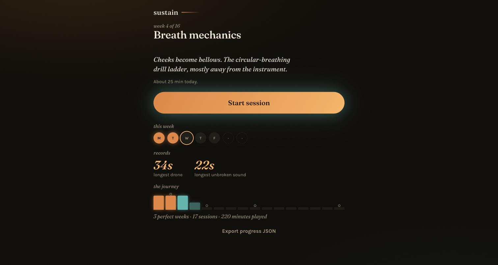
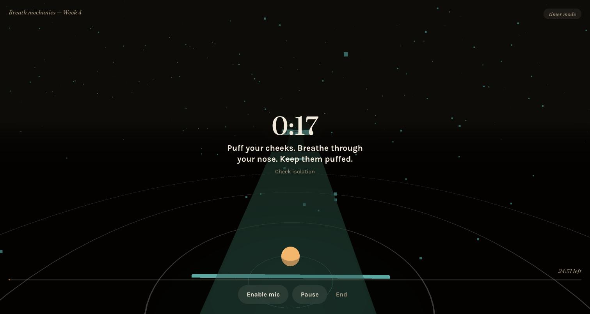
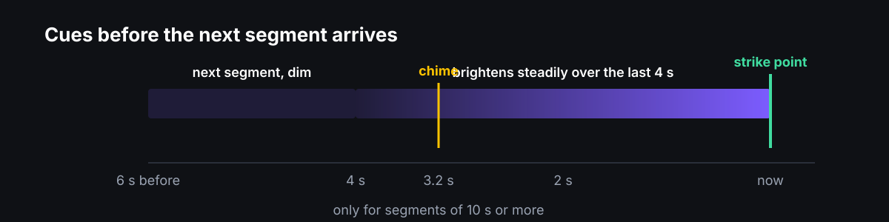

Zack Design's **[Sustain](https://github.com/isaacrowntree/sustain)** is an open-source deliberate-practice engine for musical instruments: it measures what you can actually do, and counts progress as **records, not points**. The first instrument pack is **didgeridoo**, because I snore, and a randomised controlled trial says four months of didgeridoo practice roughly halves obstructive sleep apnoea. The trial's dose was at least 20 minutes a day, five days a week, for four months, about 120 sessions. The pack encodes that as **16 weeks in four phases**, with the browser's microphone checking that the 20 minutes were spent actually droning. It runs **entirely in the browser, with no server**. **MIT licensed.**

<div class="hero-cta-row" style="margin: 1.5rem 0;">
  <a href="https://github.com/isaacrowntree/sustain" target="_blank" rel="noopener" class="btn btn-primary btn-lg">Source on GitHub</a>
</div>

This post covers:

- why the real intervention is turning up 120 times, and what already existed;
- the score the instrument already keeps, and how a "perfect week" is prorated when you join on a Wednesday;
- a session as a three.js lane, and what it does at 4 s, 3.2 s and 9 s;
- listening without a server: why the microphone is opened with WebRTC's processing switched off, why pitch comes from a 4096-sample autocorrelation window and not an FFT (a frequency analysis), and the 400 ms onset and 250 ms grace that stop a wobble ending your record;
- instrument packs as data, where it's at, and how to run it.

<!-- more -->

## Why it exists: the treatment is turning up 120 times

I played trombone at a decent level, then stopped for years. I also snore, and the suggestion that came back was: play the didgeridoo.

That sounds like folk advice. It isn't. [Puhan et al., BMJ 2006](https://pmc.ncbi.nlm.nih.gov/articles/PMC1360393/) is a randomised controlled trial of 25 people with moderate obstructive sleep apnoea, over four months. The didgeridoo group's apnoea–hypopnoea index (breathing pauses and shallow breaths per hour of sleep) dropped by about half. Daytime sleepiness improved significantly, and so did how much their partners were disturbed.

It later won the 2017 Ig Nobel Peace Prize, which makes people assume it's a joke. The mechanism is unglamorous: circular breathing and sustained droning are resistance training for the upper airway. The same effect shows up in the [myofunctional-therapy literature](https://pubmed.ncbi.nlm.nih.gov/19234106/) with no instrument involved.

The part nobody puts on the poster is the dose. The protocol was at least 20 minutes a day, at least five days a week, for four months. The participants beat it, averaging about 25 minutes across nearly six days. That's roughly 120 sessions. The intervention isn't the didgeridoo; it's turning up 120 times.

So my problem wasn't "how do I play the didgeridoo". It was "what gets me to session 87".

## What already existed

- **[Silent Sleep Training](https://silentsleep.training/)**, from the company of Alex Suarez, who taught the BMJ trial's participants, bundles a silicone instrument with an app that listens to a 15-minute daily session.
- **[Didge For Sleep](https://didgeforsleep.com/)** is a travel didgeridoo plus a video course, with no app and no tracking.

What didn't exist was a real didgeridoo, a 30 to 40 minute guided session, and a microphone that checks you played. Trainers that listen (Yousician, tonestro) need pitched pieces and can't score a drone. A GitHub search for a circular-breathing trainer returns an acoustic-impedance calculator and an operating system.

So I built one, as the general thing: a drone hold and a trombone long tone are the same exercise in different hats.

## The instrument already keeps score

The easy version is a Duolingo skin: streaks, XP, a celebration when the bar fills. But the didgeridoo already keeps score honestly. Your longest unbroken drone is a real number about your actual throat. Wrapping fake currency around a real measurement doesn't add motivation; the [overjustification research](https://pubmed.ncbi.nlm.nih.gov/10589297/) suggests it pushes it out.

So progression *is* the curriculum. It's three mechanisms in `packages/core`.

**Records, not scores.** The pack declares two metrics, `longest-drone` and `longest-unbroken`, and higher is better for both. A record is a `{ value, date, verified }` entry, where `verified` says whether a microphone measured it or you typed it. The test in `core.test.ts` records 12, then 10, then 20. The first and third are personal records, the second isn't, and the third reports `previousBest: 12`.

**Unlock by demonstration.** A drill lists its prerequisites, and `unlockedDrills()` in `unlocks.ts` is the whole gate:

```ts
    case 'metric': {
      const best = state.bests[req.metric];
      if (!best) return false;
      const def = pack.metrics.find((m) => m.id === req.metric);
      return def?.direction === 'lower' ? best.value <= req.gte : best.value >= req.gte;
    }
    case 'self-report':
      return state.selfReports[req.id] === true;
    case 'drill-completed':
      return (state.drillCompletions[req.drill] ?? 0) >= (req.times ?? 1);
```

The circular-breathing chain in the didgeridoo pack runs in a fixed order:

1. cheek-puff breathing, three times;
2. water spray, twice;
3. straw and glass, three times, plus a self-report: "Can you keep the straw bubbles unbroken through a sniff?";
4. circular breathing on the didgeridoo, twice;
5. bridging the gap.

After that, the unbroken-sets drill needs something measured: a single unbroken note of 60 seconds. When nothing has been shown yet, the session compiler walks back down the chain. The week-six test checks the session holds cheek-puff breathing, not circular breathing.


**Perfect weeks, not daily streaks.** The trial's protocol is five days a week, so rest days are scheduled, not failures. The [habit-formation research](https://onlinelibrary.wiley.com/doi/10.1002/ejsp.674) found a single missed day doesn't harm forming a habit. Two details in `adherence.ts` took more thought than the rest of the file. The first is the week you join:

```ts
    // The join week only asks for the practice days that were still ahead.
    let target = fullTarget;
    if (wk === mondayOf(join)) {
      const missedDays = Math.min(daysBetween(wk, join), fullTarget);
      target = Math.max(1, fullTarget - missedDays);
    }
```

Join on a Wednesday and practise Wednesday to Friday. The test checks that `target` is 3, the week is perfect, and the streak is 1. Nothing is more discouraging than a program that opens by scoring you against days that went by before you downloaded it.

The second is the make-up. `compileSession()` returns `null` on a rest day, unless it's called with `{ makeup: true }`. The adherence test practises Monday to Thursday, misses Friday, plays Saturday, and checks the week is perfect. Nearly every habit app treats the miss as the event to punish. The thing worth protecting is the return.

A day can also span several sittings, and **Mark today as done** credits practice done away from the screen, in the minutes you say.



That bar chart is the sixteen weeks: height is sessions completed, colour the phase. It's the only "gamified" element, and it's a picture of the truth.

## A session is a lane

Thirty-five minutes of staring at a countdown is how a practice habit dies. So a session is a lane of timed segments flowing toward you in a three.js night scene. It's the Guitar Hero *sustain bar*, stretched to the length of a breath.



The whole scene is one 449-line class, `PracticeScene` in `apps/web/src/scene/scene.ts`. A segment is `seg.seconds * SCALE` units long, with `SCALE = 0.55`. Playing segments are 0.42 units tall and the full 2.2-unit lane width; rests are 0.1 tall and 45% width. The lane moves by `elapsed * SCALE` each frame, so the strike point stays put. The rest is borrowed from software that solved these problems years ago:

- **The next segment brightens** over its last 4 seconds: a warning, not a countdown. A chime fires at 3.2 s, only for segments of 10 s or more, so short rests don't chime nonstop.
- **Rests get a breathing halo** on an 8 s cycle, `0.5 - 0.5 * Math.cos((t % 8) * (2π / 8))`, paced like the Apple Watch Breathe animation. In a didgeridoo program the rests are breathing exercises. Under `prefers-reduced-motion` it holds still.
- **The on-screen controls fade** after 9 seconds without a pointer move, tap or key press, and any input brings them back.
- **The played trail** rides behind the strike point: bright where the drone lived, dim where it dropped.



The session saves every two seconds, so a reload picks up where you were.

One thing I got wrong, and fixed in a nine-line commit. The camera sat at `(0, 2.4, 4.6)` looking at `(0, 0.5, -7)`, and from there the upcoming segments stacked into each other. Raising it to `(0, 3.1, 4.4)` and looking further down the lane at `(0, 0.35, -8)` made the lane ahead readable. A later commit dropped the bloom multiplier from `0.8` to `0.5`, because the ember was flaring the whole scene.

## Listening without a server

Checking that you played comes in three tiers, and the app is fully usable at the first. The engine doesn't care which tier produced the frames:

```ts
 *  - 'timer'  — always playing while running (honor system, no mic)
 *  - 'energy' — mic loudness gate (reactive visuals, coarse credit)
 *  - 'pitch'  — pitch-verified playing (auto-measured metrics)
```

The timer is the default until you allow the mic; the BMJ trial used a paper diary. The energy tier's gate is `max(0.01, noiseFloor * 3)`, with the floor learned only from quiet frames. The pitch tier is where the work was.

**The browser fights you.** Opening the microphone with default settings quietly turns a drone down. `mic.ts` explains why, in the comment above the call:

```ts
/**
 * Open the mic with browser audio processing disabled. WebRTC noise
 * suppression classifies sustained tones as background noise and attenuates
 * them, and auto-gain pumps a continuous drone — both must be off.
 */
```

So it's `echoCancellation: false, noiseSuppression: false, autoGainControl: false`, all three.

**Not an FFT** (a frequency analysis). Pitch comes from [pitchy](https://www.npmjs.com/package/pitchy)'s McLeod Pitch Method, which compares the waveform with shifted copies of itself (autocorrelation):

```ts
const WINDOW = 4096; // ~85 ms at 48 kHz — 5-7 periods of a 60-90 Hz drone
```

`findPitch` returns a frequency and a clarity. A frame counts as playing when the clarity is high enough and the pitch is inside the pack's band. The thresholds come from the pack, not the detector. The didgeridoo pack sets `minHz: 50, maxHz: 100, minClarity: 0.8, stabilitySemitones: 3`, with a comment that a beginner's drone wobbles, and too strict a gate reads as "the app can't hear me". The 50 to 100 Hz band keeps speech and room noise out, so the other two can afford to be forgiving.

Two more gates follow. Over any one-second window with at least five samples, a pitch spread wider than 3 semitones isn't a drone. And a quiet reading within 1 Hz of 50 or 60 Hz is mains hum, not you.

**The smoothing lives in the clock, not the detector.** `PlayingClock` in `clock.ts` has two constants, `onsetMs = 400` and `graceMs = 250`. Frames have to read as "playing" for 400 ms before the clock starts. Then that whole window is credited back: you were playing during it, and the clock was just waiting to be sure. Once running, a gap shorter than 250 ms keeps crediting through the wobble.

Each frame can credit at most 500 ms, and a gap over 2 seconds counts as a break (a tab in the background, say). So a stall can't mint minutes. Swapping sources resets the clocks, so timer time can never be reported as verified.


All of it runs in the browser. Progress and recordings live in IndexedDB, the browser's built-in database, through a 79-line wrapper I wrote. Apart from its own packages, the web app's only runtime dependency is `three`. There's no account, no server and no telemetry. The only outside requests are to Google Fonts, for Fraunces and Karla.

## Packs are data

An instrument pack is three things: metrics, a curriculum of phases and drills with prerequisites, and a spec for how to listen. The engine's entry point is one function:

```ts
export function compileSession(
  pack: InstrumentPack,
  day: ProgramDay,
  unlockedDrillIds: Set<string>,
  options: CompileOptions = {},
): CompiledSession | null {
```

Session length ramps up across each phase. The didgeridoo pack is five days a week for 16 weeks, in four phases:

| Phase | Weeks |
|---|---|
| Foundation | 1–2 |
| Breath mechanics | 3–5 |
| Connection | 6–9 |
| Endurance & voice | 10–16 |

Each phase ends with a measured assessment on its last practice day. The third is named "The loop", and its description ends "Sixty seconds is the gate."

The useful accident is that the pitch analyser doesn't care about the instrument. A trombone pack is the same detector with a different `minHz` and `maxHz`. It gets more out of it, too, because a detector that reports hertz can measure how steady a long tone is, in cents. Guitar needs a detector that hears chords, which is a different problem, and is marked help-wanted rather than pretended at.

## Where it's at

Sustain is written in TypeScript, across five packages: the engine, the audio pipeline, the pack kit, the didgeridoo pack and the web app. Everything works end to end. Its tests cover the engine, the clock and storage; the scene is checked by looking at it.

The pack records 30 seconds of you on day one and again at week 16. A Compare view on the home screen plays them back to back, and says "not recorded yet, week N of 16" until the second exists.

Export is one JSON file with every recording inside. Import checks everything before writing anything, so a damaged file leaves the browser untouched, and it asks before replacing progress.

The instrument is a PVC didgeridoo from [African Drumming](https://africandrumming.com.au/). The BMJ trial gave its participants plastic instruments because they're easier to learn on. The effect comes from what your airway is doing, not what the tube is made of.

## Trying it

There's no hosted demo, and the app never sends your data anywhere. The repo now uses [Bun](https://bun.sh) rather than pnpm:

```sh
git clone https://github.com/isaacrowntree/sustain && cd sustain
bun install
bun run dev     # web app on http://localhost:5173
bun run test    # engine, pack and web app tests
bun run build
```

Open it in a browser, allow the microphone when you press Start, and drone. It works without the microphone too, on the honour system.

## What I learned

The browser's audio defaults are tuned to remove exactly the signal a drone is. The clock needs more care than the detector. And the hard part of a habit app is the week you join and the day you miss.

So there's a curriculum, a coach, an instrument, and an empty progress file. The day-one recording is on disk, and the summit will play beside it when it lands. The trombone pack is next. Ask me in December.

A note worth making plainly: the didgeridoo is an Aboriginal Australian instrument. It's known as the *yidaki* to the Yolŋu people of north-east Arnhem Land, with a ceremonial history that long predates its use against snoring. Sustain is a practice timer for a breathing exercise. It makes no claim on any of that.

*Header photo by [Wil Stewart](https://unsplash.com/@wilstewart3) on [Unsplash](https://unsplash.com).*
