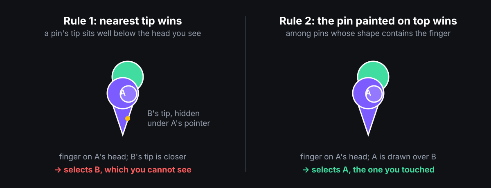
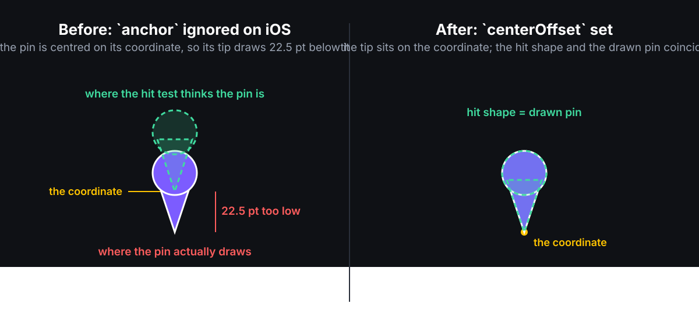

[CamperMate](https://campermate.com) is a map. Its users look for a campsite in a pack of forty pins around Queenstown, and the whole product is the tap that opens the right one. No map SDK tells you which pin that is. In a dense pack, iOS hands you the pin next to the one you touched. Android hands you the one underneath. The website hands you whichever pin's rectangle your finger fell in. The documentation for `react-native-maps`, MapKit, the Google Maps SDK and Mapbox GL is not wrong, exactly. None of it says what the SDK hit-tests.

The rule that works decides the tap in JavaScript: from the finger position, against the pin as drawn, in the order it is painted. Checking it takes a test rig on each platform that puts real fingers on real pins and reads the pixels back. Claude Fable 5.1 built it, after reading the SDK sources rather than the docs. Reasoning alone gets this wrong. The rig's sharpest finding is that on Apple Maps the `anchor` prop does nothing, so every iOS pin sits 22.5 points below the shape the hit test checks.

This post covers:

- why each SDK's tap handling picks the wrong pin;
- the tap rule that works: the finger position, the pin as drawn, the order it is painted;
- the dead ends: rules that look right and are wrong, and theories the test rig disproves;
- how the rig verifies taps, from pixel checks on a laptop to real touches on dense packs of real data;
- making Android taps fast: 22 ms instead of 649 ms;
- the web port, where Mapbox's query order is not its paint order;
- whether this would be easier without React Native, and what we would tell someone starting this.

<!-- more -->

## Why the SDKs pick the wrong pin

The app's map is `react-native-maps` 1.29 on Fabric, React Native's newer rendering layer. On iOS the map is MapKit. Every pin is a live React Native view inside an `MKAnnotationView`, MapKit's container for a pin. On Android the map is Google Maps, and every pin is a bitmap drawn natively from the same geometry, so the two look identical. The website uses `mapbox-gl`. Mapbox draws the pins itself from a list of points: a symbol layer over a GeoJSON source.

When a finger lands on a cluster, the app needs one answer: which pin did the user touch? Each SDK answers a different question.

- **MapKit** tests the whole rectangle the pin is drawn in. A pin is a circle on a pointer, so most of that rectangle is empty space beside the pointer. Tap the empty corner beside pin A's pointer and MapKit reports A, even when your finger is visibly on the head of pin B behind it.
- **Google Maps** tests a zone that does not line up with the pin at all. For custom marker images the zone is bigger than the image and shifted upward. It is a long-standing SDK defect, and worse on real phones than on the emulator. On a Samsung A13 with real touches, a finger dead-centre on pin *b* is reported as the pin beside it. A tap on empty map well above a pin counts as a tap on that pin.
- **Mapbox GL** tests its "collision box", the rectangle it uses to stop labels overlapping. For our pins that is the whole image, including the transparent margin reserved for badges. So the clickable area is half as wide again as the pin you can see.


Three SDKs, three rectangles. The `react-native-maps` documentation says a marker has an `onPress`. MapKit's says an annotation view is selected on tap. Google's says `onMarkerClick` fires for the marker that was clicked. Mapbox's says `queryRenderedFeatures` returns the features at a point. All true. All silent on the shape being tested. That silence is the whole bug.

## The tap rule that works

The rule is the same on every platform. Don't ask the SDK which pin. Ask it where the finger was, project the nearby pins to the screen, and decide against the shape we actually draw, in the order we actually paint.

That needs two things the SDKs do not hand over by default: the finger position and an agreed shape.

**The finger position.** On Android, the library's marker-click event reports the marker's position, not the tap's. The patch reports the tap location instead. The touch handler already captures it, and presses on polygons and lines already use it. On iOS it takes two small patches, both for upstream bugs on the Fabric path:

- `RNMapsMarkerView.mm` builds the press position by reading `x` and `y` out of a dictionary that only holds latitude and longitude. So every marker press on the new architecture reports its position as zero, zero: the top-left corner of the screen.
- `AIRMapMarker.m` measures the finger relative to the pin's callout view. With no callout open, that view does not exist, which also gives zero, zero. The patch measures the finger relative to the map (`[recognizer locationInView:marker.map]`).

On the web the position is free, because the click event has it. Mapbox is only asked for the pins drawn in a box around the click. The box is a little bigger than a pin, so a pin whose edge is near the click is included. The decision is made from there.

**The shape.** One small file describes the pin as a circle sitting on a pointer. Every measurement is taken from the tip, the point that sits on the map coordinate:

```json
{
  "circleCenterAboveTip": 26,
  "circleRadius": 15,
  "pointerTopAboveTip": 17,
  "pointerHalfWidth": 12,
  "containerWidth": 40,
  "containerHeight": 45
}
```

Everything reads it. The JavaScript hit test uses it. The Android code that draws the pin is tested against it pixel by pixel, and so is the iOS view, rendered into a bitmap. The website's `pinGeometry.json` carries it verbatim. A browser test (Playwright) draws the web pin on a real canvas and checks every pixel's transparency against the same shape rule.

The file exists because a hand-copied rectangle drifts. A renderer change that moves the circle two pixels leaves the hit test describing a pin the app no longer draws, and nothing ties the two together. With one file, they cannot disagree without a test failing.

The silhouette test is small:

```ts
export function isInsideMarker(dx: number, dy: number, g = MARKER_PIN_GEOMETRY): boolean {
  const fromCentreY = dy + g.circleCenterAboveTip
  if (dx * dx + fromCentreY * fromCentreY <= g.circleRadius * g.circleRadius) {
    return true
  }
  if (dy <= 0 && dy >= -g.pointerTopAboveTip) {
    const taper = -dy / g.pointerTopAboveTip // 1 at the top edge, 0 at the tip
    return Math.abs(dx) <= g.pointerHalfWidth * taper
  }
  return false
}
```

It is a circle plus a tapering pointer, not a rectangle drawn around the whole thing. A rectangle is exactly how you get "the touch target is wider than the marker".

The other half of the rule is which pin wins when outlines overlap. The obvious answer, the nearest tip, is structurally wrong. A pin's circle sits about 26 pixels above its own tip. So when you tap the circle you can see, you lose to whichever pin has its tip under your finger. That pin's circle is usually hidden behind the one you aimed at. Nearest-tip alone produces Android's "selects the one underneath".

The rule that works: among pins whose outline contains the tap, the one painted on top wins, because that is the one the user can see. Search decides what "on top" means. Every place comes back from search with a relevance score, and the more relevant place is drawn over the less relevant one. The tap rule reads the same number that sets the drawing order. If those two ever disagreed, the user would tap the pin they can see and get the one behind it.

 If the finger misses every pin outline, the nearest pin within about twelve pixels wins. That allowance exists because a fingertip is about 7 mm wide, while the pointer is only three pixels wide near its tip. A tap that is clearly at a pin often lands just outside its outline.

## Dead ends

### Rules that look right and are wrong

The rule above is not enough by itself. It depends on four things, and the obvious version of each one fails on a phone. Get them wrong and Android pins with nothing near them open a different pin, while some iOS pins stop responding at all. Unit tests don't catch any of this, because they encode the same assumptions as the code. Every test you write agrees with you.

| What the user sees | Why | What the rule does instead |
|---|---|---|
| Android: a lone pin opens a different place | Two places sit at the same coordinate. It is natural to assume Google draws them in the order they are sent. Google's documentation says the order is arbitrary, and it is. The tap rule picks the one it thinks is on top, and Google has drawn the other one on top. | Every pin gets its own stacking number, built from its search relevance with a tiebreak, and both the drawing and the tap rule use that same number. |
| iOS: the same, in dense packs | A fraction in the stacking number looks like a cheap way to keep it unique. iOS stores that number as a whole number, so the fraction is silently thrown away and pins tie again. | Whole numbers only. |
| iOS: a pin lights up and immediately goes dark | iOS reports each tap twice, once from the pin and once from the map. The second report deselects what the first selected. | The first report of a tap wins; any repeat at the same spot within half a second is ignored. |
| iOS: some pins ignore taps | MapKit's rectangle catches a finger just outside a pin's outline. Replace that rectangle with the silhouette alone and nothing catches it. | The nearest pin within about twelve pixels wins, which is also how a fingertip 7 mm wide actually lands. |

The tiebreak is a hash of the place's own id. Ranking by position in the result list looks equivalent and isn't. It renumbers every pin after a dropped one on each pan, and on Android that re-sends every pin's stacking number to the map.

### Theories the rig disproves

A real report: *"I'm literally clicking one POI a very long way away and an iOS marker on the other side of a mountain range turns on."* The obvious theory is view recycling. Fabric reuses the native view behind a pin for a different pin. If the old pin's annotation is still on the map, a tap on it is reported under the new pin's name. A patch to the recycling hook, `prepareForRecycle`, disconnects the old annotation and takes it off the map.

It is plausible. Reverting it makes a test fail. And it is not the cause. With the patch reverted, a test that creates and destroys pins twelve times over through the real renderer leaves no stale annotations behind. The patch stays in as a precaution.

The test that checks where each pin's frame sits finds the actual cause. **On Apple Maps the `anchor` prop does nothing.** The docs do say so, in one line that is easy to miss: "iOS: Google Maps only. For Apple Maps, see the `centerOffset` prop." Pass `anchor` on both platforms and nothing at runtime warns you.

Asking for the pin to hang from its bottom centre (`anchor {0.5, 1}`) has no effect. The Fabric marker in `react-native-maps` reads only `centerOffset`, which defaults to zero. So every pin, 40 points wide and 45 tall, sits centred on its coordinate, with its tip drawn 22.5 points too low. The JavaScript hit test assumes the tip is on the coordinate, so the shape it checks floats 22.5 points above the pin the user can see. Empty map above a pin selects it. A tap on the drawn circle mostly misses and falls through to the nearest-pin fallback. Even an info-window lift "tuned on device" inherits the error from the low-drawn pins.

The fix is one constant, `{0, -containerHeight / 2}`: shift the view up by half its own height. Every iOS pin then sits on its coordinate, in line with Android.



### Other findings from the screen

- **Raising the selected pin makes every pin blink (iOS).** A frame-difference filter over a cluster far from the tapped pin shows every other pin blanked for two frames. Fabric treats a change to a pin's stacking number (`zIndex`) as a reorder of siblings. It does that by removing and re-inserting the view, and MapKit lays out every annotation again on any add or remove. Raising the selected pin by 1,000 instead of 999,999 flashes just the same. A separate overlay marker mounted on top does not. So base pins never change props when selected; the highlight is its own marker on both platforms.
- **The peek is slow to disappear because of the wait, not JavaScript.** JavaScript dismisses it within 50 ms of the map reporting a press. The wait comes before that. On both platforms, the single-tap recogniser waits to see whether a second tap follows before it reports the first. So the peek hides the instant a finger touches the map, and the selection clears once the tap is confirmed.
- **An invisible strip under the card.** If the info window's tappable area includes the strip, the full width of the card, between the card and the pin, tapping the gap opens the place on both platforms. The tappable area is the card itself.
- **On Android, showing an info window overrides the stacking order.** `react-native-maps` calls `showInfoWindow` on every tapped marker when `moveOnMarkerPress` is off. Google draws the marker whose window is showing above every other marker, whatever its stacking number, and an empty window still counts. So the selection overlay renders perfectly, and invisibly, underneath. The patch shows a window only for a marker that has one. The proof is the pixel at the circle centre.
- **A tap on empty sea opens a random place (Android)** if the code falls back to whichever marker Google named. The finger misses every pin outline, and no pin is within the twelve-pixel allowance. Android's finger position is exact, so a miss there is a background tap. iOS keeps its fallback, because MapKit's frame is at least the pin's own box.
- **An invisible dev-only control.** A 96-by-72-pixel button for triggering end-to-end tests renders in every dev build. It is transparent, sits in the left-middle of the map, and eats taps. "This popup broke marker clicks" is true, and the popup is innocent.

## How the rig verifies taps

Every layer between our code and the screen has an opinion about what a tap means, and every one of them is wrong somewhere. So the rig runs the real app, uses the real SDK and puts a real finger down, testing native code and JavaScript together. It takes its answer from the one place none of those layers can edit: the screenshot.

It has four layers of tests, each catching something the one below cannot.

**1. Draw the Android pin on a laptop and check every pixel.** No phone, no emulator. The code that draws the Android pin runs on an ordinary computer under Robolectric, a tool that lets Android code run outside a phone. The result is compared pixel by pixel with the shape file, at the screen densities of our test phones. A second test saves the drawn pins as images and runs the tap rule over them. That checks the code that draws and the code that decides against each other, in one place.

**2. Run Apple's real map code inside the real app.** Apple's map classes, and the layer of `react-native-maps` on top of them, cannot be tested on their own. They only compile as part of the app. So the iOS tests live in a separate project that loads the actual CamperMate build and drives its map objects directly: create a pin, remove it, reuse it, tap it, ask where its frame is. Three more tests mount a second, test-only screen inside the running app's own React Native instance, then read back what JavaScript received. Every patch to the SDK is checked by undoing it and confirming that exactly one test fails.

**3. Put real fingers on real pins, where the test says they are.** On iOS, a test places three pins on the live map, writes their screen positions to a file, and waits. A script reads the file and uses Maestro, a tool that taps a phone's screen from a script. It taps the map above pin *a*, the centre of pin *b*, and the empty corner beside pin *c*. The test then checks what JavaScript was told. One lesson: touches never reach a test window unless it has a root view controller, the iOS object that owns what a window shows.

**4. Real fingers on Android, inside the running app, judged by a screenshot.** An Android test mounts the same test-only screen inside the app. It works out where each pin's image is from Google's projection and the pin's anchor, and injects real touches there. Android has no way to ask which pin it drew on top, so the test reads the screen. It takes a screenshot, looks at the pixel at the centre of the selected pin, and checks that it is the brand yellow before and after the tap. Three lessons from this one:

- the standard automation click never reaches this window;
- the app has no keyboard focus for about ten seconds after the screen mounts;
- two touches on one spot within 0.7 s count as a double-tap zoom.

Three layers of software never agree on what a tap means, and the only description of the truth is the pixels on the screen.

### Dense packs, with real data

Three pins on a test screen is not what users see. Around every popular tourist town, CamperMate shows a dense pack of pins all the time: Queenstown, Wellington, Byron Bay. That is where the wrong-pin bug lives. So the tests use real data. A script pulls up to 250 of the nearest places around each of six such towns, 1,266 in all, straight from the production search index.

A test lays each scene out on a phone screen at four zoom levels, from whole town down to a single block, in the app's paint order. Then it simulates a tap every three pixels across the whole pack: tens of thousands of taps per scene. It checks four things:

- the hit test returns the pin painted at every pixel;
- the geographic pre-filter, which picks the nearby pins worth checking, never drops that pin;
- every pin with any visible ink can be tapped;
- one tap over the densest pack takes under 2 ms.

It catches a flaw that reads fine in code. A nearest-pin fallback that keeps a running best lets near-ties drift along a chain: B to C to A, each within the tie band of the last. It can end up answering a pin farther away than the nearest, or one beyond the twelve-pixel allowance entirely. So ties are measured from the minimum distance, and the allowance is a hard limit on the answer.

On device, four real touches on 160 real Wellington places at suburb zoom score four of four on iOS and four of four on Android. Each is checked against the pin the operating system actually painted on top. On iOS that is decided by each layer's stacking position. The system's own hit-testing walks the view tree in a different order, so it cannot be the answer key.

## Making Android taps fast

A correct Android tap still feels slow next to iOS, most of all when switching between info windows. Every Android tap waits on Google. When a finger lifts, the Google Maps SDK holds the event for 300 ms, to see whether a second tap follows, because two taps mean zoom. Only then does it run its own marker hit test and call the app. iOS pins have their own tap recogniser and never wait. Measured on the arm64 emulator, from the finger touching the screen to the app's JavaScript hearing about it:

| tap | waiting on Google | finger-up dispatch |
|---|---|---|
| empty map | 295 ms | 21 ms |
| centre of pin *b* | 649 ms | 22 ms |
| dead corner of pin *c* | 709 ms | 22 ms |

The patch listens for the finger lifting, on the gesture detector that already sees every touch before Google does. It tells the app right then, with the finger position. Google's own callbacks for that same lift are then ignored. A flag is set when the fast path fires and cleared when the next finger comes down. A long press or a drag that Google consumed is never also a tap. And the tap's screen position is converted to a map position once and reused, rather than crossing between native code and JavaScript three times in a row.


Android pins fade in over 250 ms once their bitmap lands. That also hides Google's red default pin while a cold bitmap decodes. The old native app had the same entrance.

Two traps sit outside what the rig sees. A pin whose image fails to load can be left fully transparent: invisible, but still tappable. Both failure paths fall back to Google's default pin. And in the location picker, Google's My Location button becomes a map press, dropping the pin under the button. The screen has its own button, so Google's is off.

One behaviour is a deliberate trade. A double-tap to zoom with a peek open closes the peek on the first tap. That is the same as iOS.

## The web port

The website's Mapbox map has the same complaint, plus a panel that shows the previous marker's photo when you click a different one.

The `mapbox-gl` source, rather than its docs, shows the same class of defect. Mapbox resolves a click on a symbol layer against the icon's collision rectangle: the whole padded canvas, transparent badge margins included. So a tap in the dead corner of one pin's box, over the visible head of a lower pin, selects the wrong pin.

Two handlers answering every click make it worse. If the layer's handler sets the selection and a map-level handler then re-queries one pixel and clears the selection when the query disagrees, a finger 5 px off a 36 px head counts as a background click and closes the panel. The stale photo is simpler. Without a React `key` on the panel's image element, React reuses the same element and only changes its address. The browser keeps painting the previous place's photo until the new one downloads.

The port is almost verbatim. `lib/Maps/markerHitTest.ts` on the web is the app's hit test. `pinGeometry.json` is a copy of the app's geometry, with the app's Android drawing constants alongside, so the web pin matches the app's pin to the pixel.

One click handler owns the click. Mapbox lists the pins drawn in a box around the click, and each is converted to a screen position. Then the same rule decides. The pin whose outline holds the click wins, topmost first. Failing that, the nearest pin within about twelve pixels wins. Otherwise the click was on the background, exactly as on Android, because a mouse pointer is exact.

The dense-pack sweep is ported with its six towns. A Playwright test bundles the real renderer, draws the pin on a real canvas and checks every pixel's transparency against the shape rule. It is the web's counterpart of the Android laptop test. Another drives the real desktop map with a mouse. On the Queenstown pack there are 44 points where Mapbox's rectangle names the wrong pin and the silhouette names the right one.

The web has two traps the apps do not.

**Mapbox's query order is not its paint order.** Taking the order `queryRenderedFeatures` returns as the draw order looks safe, and a reading of the 3.29 source seems to confirm it. That holds only for layers Mapbox sorts by screen position, top to bottom. Our pin layer sets a sort key instead, so that search relevance decides what draws on top, as in the app. With a sort key set, `mapbox-gl` never records its draw order at all. It returns results in the reverse of the order the data arrived, unrelated to what it drew.

So under that assumption the wrong pin wins whenever results arrive most-relevant first, which is the common case. A test whose answer key shares the assumption passes anyway. Paint order comes from each feature's own sort key, with the query position as the tiebreak for equal keys. The test's answer key applies that rule independently. The pointer cursor uses the same resolver too. Otherwise the cursor promises a click on the rectangle's corners that the silhouette then reads as background.

**`map.project` returns one world copy.** Take a pin drawn on a wrapped copy of the world: any low zoom with copies rendered, or a Chatham Islands viewport. Projected naively, it lands a world away from the click and reads as background. So each candidate is projected three times: at its own longitude, and one full world width east and west. The copy nearest the click is kept. The info window's placement has the same seam problem and reuses the helper.

The info window is an absolutely positioned element, not part of a DOM marker. Lifted a flat 18 px, it sits over the head of its own pin and loses its tail, the small triangle pointing at the pin. Unreliable taps hide where the card lands. So the lift comes from the shared geometry, and the tail is drawn. The placement rule is the app's: above, below when there is no room, beside at the edges, tail always on the pin.

One thing does not port. In Mapbox, `icon-size` is set per layer, not per pin, so the app's iOS sprout animation is not available on a symbol layer. Opacity is per pin, so the web pins fade in instead, Android's entrance, over 150 ms.

## Would this be easier without React Native in the way?

It is a fair question. The six upstream issues below are all `react-native-maps` bugs, and it would be easy to read this post as "React Native made maps hard". The honest split is about one third to two thirds.

**The part the SDKs own, which native hits just the same.** The CamperMate apps before React Native used the Google Maps SDK on both platforms. Both took the SDK's answer as the answer. The iOS app's `didTapMarker:` and the Android app's `OnMarkerClickListener` each opened whichever marker Google named, with no hit test of their own. So Google's oversized, upward-shifted hit zone was in those apps for years. So was Google's 300 ms wait before reporting a single tap, since the native apps waited on the same callback.

The rest is SDK too: arbitrary draw order for two markers at one coordinate, `showInfoWindow` pulling a marker above every stacking number, and no SDK telling you which marker it painted on top. A native app that wants the right pin needs the same silhouette, the same paint-order rule, the same finger-up dispatch, and a screenshot to check its work.

**The part React Native adds.** Every bug in the "finger position" half of the fix is the bridge. A press position read out of a dictionary that only holds latitude and longitude. A finger measured against a callout view that does not exist. Android reporting the marker's position instead of the finger's. A native app gets the touch point from the gesture recogniser or the motion event and never has this problem.

`anchor` doing nothing on Apple Maps is a leak in an abstraction; the old iOS app set `groundAnchor` itself, in one line. Whole-number stacking numbers, the blink when one pin's `zIndex` changes, and the tap reported twice are all artefacts of the layer in the middle. And most of the effort goes into the rig. With three layers between the finger and the SDK, the only way to test is to mount a screen inside the running app and inject touches from outside it. Natively, that is an ordinary XCTest or Espresso test with the views in hand.

One caveat cuts the other way. Native makes it easier not to notice. The native apps tolerated the hit-test defect for years, because no framework amplified it into "a marker on the other side of a mountain range turns on". React Native made it bad enough to force the fix. The fix itself, silhouette plus paint order plus finger position, is the same on every platform, and is worth doing natively too.

## What we would tell someone starting this

- **Build the rig before the theory.** Every explanation we reasoned our way to was wrong, including one we had already patched and mutation-tested. The test that takes a screenshot and looks at a pixel is right every time. A test that shares your assumption, instead of checking the screen, passes while being wrong. When the layers below you disagree with each other, the screen is the only witness they cannot argue with.
- **No map SDK answers "which pin did I tap".** MapKit tests a frame, Google tests an offset region, Mapbox tests a collision rectangle. Their documentation describes the event, not the shape. Read the source. Then decide it yourself, from the finger position, against the shape you draw, in the order you paint.
- **Put the pin's geometry in one file** and test every renderer against it, pixel by pixel. A hand-copied hit box ends up describing a pin nobody draws any more.
- **Paint order is part of the hit test.** Make it unique, make it an integer, and read it from the same field on both sides. Never take a query's result order as the draw order without checking which sort the layer uses.
- **On Apple Maps, `anchor` does nothing and `centerOffset` is the whole story.** The docs say it in one line; nothing at runtime does. Changing `zIndex` remounts the annotation and lays out every other one again, so highlight with a separate marker.
- **Mutation-test the patches.** A hunk that stays green when reverted is decoration. One of ours was.

The `react-native-maps` changes that are general, rather than CamperMate-specific, are filed upstream with their diffs:

- the Fabric press position and the nil callout view ([#6002](https://github.com/react-native-maps/react-native-maps/issues/6002));
- the callout z-position boost that never applied ([#6003](https://github.com/react-native-maps/react-native-maps/issues/6003));
- the blink when one pin's `zIndex` changes ([#6004](https://github.com/react-native-maps/react-native-maps/issues/6004));
- Android reporting the marker's position instead of the finger's ([#6005](https://github.com/react-native-maps/react-native-maps/issues/6005));
- `showInfoWindow` raising pins above every `zIndex` ([#6006](https://github.com/react-native-maps/react-native-maps/issues/6006));
- the finger-up dispatch, with its latency table ([#6007](https://github.com/react-native-maps/react-native-maps/issues/6007)).

The Mapbox finding is on the existing report of query order ignoring `symbol-sort-key` ([mapbox-gl-js #10800](https://github.com/mapbox/mapbox-gl-js/issues/10800#issuecomment-5722789154)).

Everything else here is the shape of the work: reading what the SDKs actually do rather than what their docs say, and building something that can tell you when you are wrong.
